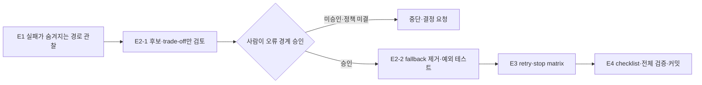

# Lab 15 — Silent Fallback을 실패로 드러내기

## 0. 이 랩이 끝나면

- 빈 배열, 기본 응답, 로그만 남기고 계속하는 **silent fallback**을 실제 오류 경로에서 찾습니다.
- 오류를 없애기 위한 빠른 fallback 후보와, 실패를 드러내는 처리의 차이를 사람 승인으로 구분합니다.
- 정책이 정하지 않은 예기치 못한 예외의 외부 응답은 임의로 확정하지 않고, 승인된 경계만 구현·검증합니다.
- `docs/retry-stop-matrix.md`를 결제 실패 처리의 재사용 가능한 참조 문서로 남깁니다.

Lab 13·14에서는 `src/`를 바꾸지 않고 오류를 검출하고 assertion을 보강했습니다. 이번 Lab은 Lab 12 이후 처음으로 앱의 오류 처리 경계를 바꾸되, 오류를 성공처럼 보이게 하지 않는 작은 루프를 완성합니다.

## 1. 시작 전 상태 확인

- 주문 상태에는 `pending`, `paid`, `payment_failed`, `cancelled`가 있으며, 실패 결제는 주문을 삭제하지 않고 `402`와 함께 보존됩니다.
- 이전 Lab의 관리자 상태 assertion 하나는 저장 상태 `payment_failed` 대신 한글 파생 표시값이 나오는 불일치를 감시하는 `it.fails()` 상태입니다. 이 Lab에서는 이 assertion을 고치거나 해제하지 않습니다.
- 한 예외 경로는 오류를 로그만 남긴 뒤 기본 응답으로, 다른 예외 경로는 빈 배열로 바꿉니다. 둘 다 호출자와 운영자가 실제 실패를 구분하기 어렵게 만드는 이번 Lab의 대상입니다.
- 이 두 fallback 제거의 회귀 방지는 E2에서 새로 만드는 예외 경로 테스트가 담당합니다. 이전 관리자 상태 assertion의 책임과 섞지 않습니다.

시작 기준이 다르거나 앱 diff가 예상 밖으로 남아 있으면 E1 전에 멈추고 차이를 기록합니다. Lab 12의 정상 흐름과 Lab 14의 기대 실패를 먼저 되돌려 맞추지 않습니다.

## 2. 실습 목표와 산출물

| 단계 | 핵심 개념 | 핵심 작업 | 결과 |
| --- | --- | --- | --- |
| E1 | silent fallback 탐지 | 실패 입력부터 외부 응답까지 정보가 사라지는 지점을 추적 | fallback 조사 결과 |
| E2 | 승인된 오류 경계 | 후보·trade-off를 검토하고, 승인 뒤 fallback 제거와 예외 경로 테스트 | 변경된 오류 처리와 관련 테스트 |
| E3 | retry와 stop 구분 | 확정 정책과 사람 판단이 필요한 재시도 후보를 분리 | `docs/retry-stop-matrix.md` |
| E4 | 결제 실패 처리 정리 | matrix에 재사용 가능한 확인 기준을 통합하고 전체 검증·커밋 | `docs/retry-stop-matrix.md` |



이 Lab의 핵심은 오류를 없애는 것이 아니라 **오류의 위치를 정하는 것**입니다. 외부에는 안전한 실패만 보이고, 서버 쪽에는 운영자가 원인을 추적할 증거가 남아야 합니다.

## 3. 실습

### E1. Silent fallback을 탐지하기

#### 설계 질문

- 실제 실패를 빈 값이나 성공처럼 보이는 응답으로 바꾸면 테스트와 운영에서 각각 무엇을 놓치나요?
- 실패 입력, 실제 오류, 외부 응답, 사라지는 정보를 한 흐름으로 어떻게 관찰하나요?
- 현재 테스트가 정상 흐름만 확인할 때 fallback은 왜 통과한 채 남을 수 있나요?

#### 판단 기준

| 관찰 축 | 확인할 내용 | silent fallback일 때의 위험 |
| --- | --- | --- |
| 실패 입력 | 어떤 조건에서 예외 경로로 들어가는가 | 정상 요청만 시험하면 경로 자체가 보이지 않음 |
| 실제 오류 | 서버 안에서 어떤 예외·원인이 생기는가 | 원인이 버려져 재현과 원인 분석이 어려움 |
| 외부 응답 | 호출자가 성공·빈 결과·실패 중 무엇을 받는가 | 실패가 정상 모양으로 바뀌어 호출자가 구분하지 못함 |
| 사라지는 정보 | 로그·상태·식별자·오류 근거 중 무엇이 보존되지 않는가 | 운영자가 장애와 데이터 문제를 추적할 수 없음 |

빈 배열이나 기본 객체가 언제나 나쁜 것은 아닙니다. **예외가 발생했는데도** 그 값을 정상 결과처럼 반환하고, 원인도 보존하지 않을 때 silent fallback입니다. 이 단계에서는 위치와 영향만 조사하며 코드는 수정하지 않습니다.

#### 실행

```text
현재 코드에서 예외를 잡은 뒤 빈 값, 성공처럼 보이는 응답, 또는 로그만 남기고 기본 응답으로 바꾸는 경로를 찾아줘. 각 경로의 실패 입력, 실제 오류, 외부 응답, 사라지는 정보를 표로 정리하고 현재 테스트가 왜 이 경로를 놓칠 수 있는지 적어라. 코드는 수정하지 마라.
```

#### 검증

- [ ] 서로 다른 모양의 silent fallback 두 경로가 구분됐는가?
- [ ] 각 경로에 실패 입력·실제 오류·외부 응답·사라지는 정보가 있는가?
- [ ] 현재 정상 흐름 테스트만으로는 왜 발견하지 못하는지 설명됐는가?
- [ ] 조사 중 앱 코드와 테스트는 수정되지 않았는가?

### E2. 승인된 오류 처리 경계로 fallback 제거하기

#### 설계 질문

- 예기치 못한 예외의 HTTP 상태와 본문을 누가 결정해야 하나요?
- 카드 정보·내부 예외·스택을 외부에 보내지 않으면서 운영자가 원인을 찾을 증거는 어디에 남기나요?
- 메모리 저장소에서 자연스럽게 나지 않는 예외 경로를 테스트에서 어떻게 일으키나요?
- 에러가 나지 않게 만드는 가장 빠른 제안은 왜 거절해야 하나요?

#### 판단 기준

예상된 결제 실패의 `402`와 내부 정보 비노출은 정책에 있지만, **예기치 못한 예외**의 상태 코드·본문·서버 쪽 보존 방식은 정책이 정하지 않았습니다. 따라서 E2에는 한 번의 승인 Gate가 있습니다. 후보를 검토한 뒤 사람이 이 세 가지를 함께 정하고, 그 승인 전에는 이 경계를 구현하지 않습니다. 승인 뒤에는 승인된 범위 안의 fallback 제거·테스트 작성에 다시 승인을 받을 필요가 없습니다.

| 후보 처리 | 실패를 성공 모양·빈 값으로 바꾸는가? | 원인 정보가 사라지는가? | 호출자·운영자가 실패를 구분하는가? | 판단 |
| --- | --- | --- | --- | --- |
| catch 뒤 기본 성공 응답 또는 빈 컬렉션 반환 | 예 | 대체로 예 | 아니오 | fallback으로 반려 |
| 안전한 실패 응답과 서버 쪽 구조화된 오류 보존 | 아니오 | 서버 쪽에 보존 | 예 | 사람 승인 후보 |
| 예외를 상위 경계로 전달 | 아니오 | 상위 계층의 처리 방식에 따름 | 승인한 경계에 따라 다름 | 사람 승인 후보 |

Codex가 fallback 후보를 내지 않으면, “예외를 잡은 뒤 빈 배열이나 기본 성공 응답을 반환해 오류를 없앤다”는 고정 후보를 **설명 수준에서만** 같은 표로 판정합니다. 이 후보는 반려하며 적용하지 않습니다.

| 정보의 위치 | 허용되는 내용 | 금지되는 내용 |
| --- | --- | --- |
| 외부 응답 | 승인한 상태 코드·안전한 오류 코드 또는 정제된 메시지 | 카드 정보, 내부 예외 메시지, 스택, 원시 오류 본문 |
| 서버 쪽 오류 보존 | 원인 추적에 필요한 구조화된 오류 근거와 요청 맥락 | 외부 응답으로 그대로 복사되는 민감·내부 정보 |

관리자나 운영자가 볼 실패 사유를 남긴다는 말은 이번 Lab에서 관리자 응답 필드를 추가한다는 뜻이 아닙니다. 이번 범위에서는 서버 쪽 오류 보존을 정하며, 관리자 실패 사유 필드는 Lab 17까지 추가하지 않습니다.

#### 실행

먼저 후보만 검토합니다. 이 단계에서는 파일을 수정하지 않습니다.

```text
@docs/payment-policy.md와 현재 fallback 조사 결과를 바탕으로, 예기치 못한 예외를 처리할 외부 응답과 서버 쪽 오류 보존 방식의 후보·trade-off를 제시해줘. 에러가 나지 않게 만드는 가장 빠른 fallback 후보도 한 가지 포함하고, 왜 반려해야 하는지 구분해라. 정책이 정하지 않은 상태 코드·본문·보존 방식은 미정으로 표시하고 파일은 수정하지 마라.
```

후보를 본 뒤 사람은 **외부 상태 코드**, **외부 본문**, **서버 쪽 오류 보존 방식**을 한 번의 세션 메시지로 승인하거나 보류합니다. 이 후보 검토·승인·E2 구현·E3 기록은 같은 세션에서 이어집니다. 새 승인 기록 파일을 만들지 않습니다. 보류라면 E3으로 넘어가지 않고 결정이 필요한 이유를 남깁니다.

승인된 경우에만 구현과 검증으로 넘어갑니다.

```text
방금 세션에서 사람이 승인한 오류 처리 경계만 적용해줘. 기존 fallback 두 곳을 새 기본값으로 대체하지 말고 제거하며, 각각의 예외 경로를 의도적으로 일으켜 외부 응답과 서버 쪽 오류 보존을 검증하는 테스트를 추가해라. 정상 결제와 정상 관리자 조회도 계속 검증하고, 승인 밖 상태·본문·저장 필드는 정하지 마라.
```

#### 검증

- [ ] 후보·trade-off와 fallback 반려가 코드 변경 전에 분리됐는가?
- [ ] 외부 상태 코드·본문과 서버 쪽 오류 보존 방식이 한 번의 사람 승인으로 확정됐는가?
- [ ] 두 예외 경로를 의도적으로 일으키는 테스트가 있고 정상 경로도 통과하는가?
- [ ] 외부 응답에 카드·내부 예외·스택·원시 오류가 포함되지 않는가?
- [ ] 실패를 새 기본값으로 바꾸지 않았고, 이전 관리자 상태 `it.fails()`는 그대로인가?

### E3. Retry와 stop 기준을 분리하기

#### 설계 질문

- 같은 입력을 다시 보내면 회복될 수 있는 실패와, 사람 확인 없이 반복하면 안 되는 실패는 어떻게 다른가요?
- 재시도 횟수·식별 방식이 정책에 없을 때 matrix에는 무엇을 기록해야 하나요?
- E2에서 승인한 오류 처리 경계를 E3의 matrix에 어떻게 남기나요?

#### 판단 기준

결제 정책은 동일 `payment_failed` 주문의 새 결제 요청을 금지하지만, 네트워크·인프라 수준 기술적 재시도의 허용 조건·식별 방식·최대 횟수는 보류합니다. 이 앱에는 외부 호출이 없으므로, 기술적 재시도 횟수를 예시처럼 지어내지 않습니다.

| 분류 | matrix에 기록할 것 | 이번 Lab에서의 처리 |
| --- | --- | --- |
| 정책이 확정한 stop | 실패 종류, 감지 신호, 중단 뒤 행동 | 반복하지 않고 정책에 맞게 중단 |
| 사람 판단이 필요한 retry 후보 | 실패 종류, 필요한 승인, 검증할 식별 방식 | `사람 승인 전 후보`로 표시 |
| E2 승인 경계 | 외부 응답과 서버 보존에 관한 승인 내용 | 별도 절에 세션 승인 내용을 옮겨 적음 |

`docs/retry-stop-matrix.md`는 운영 규칙을 새로 정하는 문서가 아니라, 확정된 기준과 보류된 결정을 분리하는 문서입니다.

#### 실행

```text
@docs/payment-policy.md와 방금 세션에서 승인한 오류 처리 경계를 사용해 docs/retry-stop-matrix.md를 작성해줘. 실패 종류, 감지 신호, 재시도 여부, 중단 뒤 행동, 정책 상태를 표로 정리하고 사람 결정이 필요한 retry는 `사람 승인 전 후보`로 표시해라. 재시도 횟수나 식별 방식을 추정하지 말고, 승인된 오류 처리 경계는 별도 절에 세션 승인 내용으로 옮겨 적어라.
```

#### 검증

- [ ] 확정된 stop과 사람 승인 전 retry 후보가 분리됐는가?
- [ ] 보류된 재시도 횟수·식별 방식을 임의로 채우지 않았는가?
- [ ] stop 사례와 사람 승인 전 후보를 포함한 retry 사례가 각각 두 개 이상 있는가?
- [ ] 승인된 오류 처리 경계가 별도 절에 남았는가?

### E4. 결제 실패 처리 매트릭스로 고정하기

#### 설계 질문

- 지금까지 기록한 실패 처리 판단을 다음 결제 변경에서도 읽을 수 있는 참조 문서로 어떻게 다듬나요?
- 외부 응답, 서버 쪽 오류 보존, retry·stop, 예외 경로 테스트의 확인 기준을 한 문서 안에서 어떻게 연결하나요?
- 전체 검증 결과와 변경 파일 범위를 어떻게 커밋 전 증거로 남기나요?

#### 판단 기준

| 확인 범위 | matrix의 `변경 전 확인`이 물어야 할 질문 |
| --- | --- |
| 오류 보존 | 원인 추적 근거가 서버 쪽에 남는가? |
| 외부 응답 | 안전한 실패와 내부 정보 비노출이 함께 지켜지는가? |
| 로그 | 단순 출력이 아니라 추적 가능한 근거가 남는가? |
| retry | 확정된 재시도와 승인 전 후보가 구분되는가? |
| stop | 반복하지 말아야 할 실패의 다음 행동이 있는가? |
| 테스트 | 정상·예외 경로가 각각 실제로 검증됐는가? |

이 단계에서는 새 checklist 문서를 만들지 않습니다. 기존 `docs/retry-stop-matrix.md`의 제목을 **결제 실패 처리 매트릭스**로 다듬고, `## 변경 전 확인` 절에 여섯 항목 이상의 재사용 가능한 확인 기준을 둡니다. 정본은 계속 `docs/payment-policy.md`이며, 이 matrix는 확정된 정책과 보류된 판단을 실제 실패 처리와 연결하는 보조 참조 문서입니다.

#### 실행

```text
@docs/retry-stop-matrix.md, @docs/payment-policy.md, 현재 변경 diff, 실제 검증 결과를 사용해 기존 matrix를 `결제 실패 처리 매트릭스`로 다듬어줘. 새 문서는 만들지 마라. 각 실패 행에서 외부 응답, 서버 쪽 오류 보존, retry·stop, 정책 상태를 구분하고, `## 변경 전 확인` 절에는 오류 보존·외부 응답·로그·retry·stop·테스트를 포함한 재사용 가능한 확인 항목을 여섯 개 이상 둬라. 정책 미결은 확인 필요 또는 사람 승인 전 후보로 표시해라. 이어서 test, lint, typecheck를 실행해 실제 결과와 미실행 항목을 구분해 기록하고, 결제·관리자 오류 처리, 관련 테스트, 이 matrix만 포함해 커밋해라.
```

#### 검증

- [ ] matrix의 제목과 목적이 결제 실패 처리 전체를 설명하며, 정본 정책을 대체하지 않는가?
- [ ] `## 변경 전 확인`에 오류 보존·외부 응답·로그·retry·stop·테스트 항목이 각각 있는가?
- [ ] matrix가 확정 기준과 승인 전 후보를 구분하는가?
- [ ] 전체 test·lint·typecheck의 실제 결과와 미실행 항목이 구분됐는가?
- [ ] 변경 파일이 결제·관리자 오류 처리, 관련 테스트, 이 matrix로 제한되는가?
- [ ] 커밋에 관리자 실패 사유 필드나 승인 밖 정책 결정이 들어가지 않았는가?

## 4. Self-check

```bash
node labs/tools/check.mjs 15
git show --stat --oneline HEAD
git diff HEAD^ HEAD -- src tests docs/retry-stop-matrix.md
```

- [ ] 두 fallback이 실패를 성공 모양이나 빈 값으로 바꾸지 않게 되었는가?
- [ ] 예기치 못한 예외의 외부 응답과 서버 쪽 오류 보존이 사람 승인과 일치하는가?
- [ ] 두 예외 경로와 정상 경로를 함께 검증했는가?
- [ ] retry·stop matrix가 정책 확정과 미결을 구분하는가?
- [ ] 결제 실패 처리 matrix 하나에 재사용 가능한 변경 전 확인 항목이 있고, 커밋 범위가 E4의 제한을 지키는가?

Self-check는 단순히 테스트가 green인지가 아니라, 실패 입력·승인된 경계·외부 응답·서버 증거·다음 행동이 연결되는지를 확인합니다.

## 5. 자주 하는 실수

- 기존 catch를 다른 빈 값이나 기본 성공 응답으로 바꿔 silent fallback을 유지합니다.
- 예기치 못한 예외의 상태 코드·본문·오류 보존 방식을 사람 승인 없이 Codex가 정하게 둡니다.
- 내부 예외·스택·카드 정보를 외부 응답에 넣거나, 반대로 서버 쪽 원인 추적 근거까지 버립니다.
- 정책이 보류한 재시도 횟수나 식별 방식을 사실처럼 적고 자동 재시도를 구현합니다.

## 6. 다음 lab으로 넘기는 것

Lab 16에는 승인된 오류 처리 경계, 실제 검증 결과와 결제 실패 처리 matrix를 PR preflight 근거로 넘깁니다. 이전 Lab의 관리자 상태 `it.fails()`는 이 Lab에서 유지하며, silent fallback 제거 검증과 같은 책임으로 설명하지 않습니다.

관리자 실패 사유 필드는 Lab 17까지 추가하지 않습니다.
