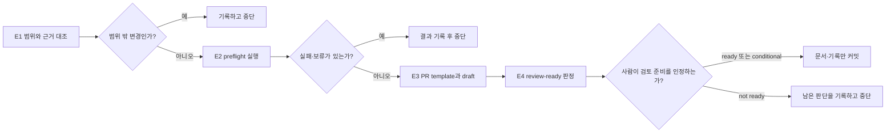

# Lab 16 — 변경을 PR 후보로 정리하기

이 랩에서는 Chapter 3에서 만든 변경을 실제 GitHub Pull Request로 열지 않고, 사람이 검토할 수 있는 **PR 후보**로 정리합니다. 코드를 더 고치는 시간이 아니라, 무엇이 바뀌었고 어떤 근거와 검증이 있으며 아직 무엇을 사람이 판단해야 하는지를 한 묶음의 증거로 만드는 시간입니다.

## 0. 이 랩이 끝나면

- 변경 범위와 근거를 정책·계획·코드·테스트·검증 기록으로 분류할 수 있습니다.
- 재사용 가능한 PR preflight checklist와 이번 실행의 결과 기록을 분리합니다.
- PR template과 이번 변경의 PR 초안을 분리해 작성합니다.
- 모든 검증 통과와 사람의 review-ready 판단을 구별하고, 조건부 준비 상태도 명확히 남깁니다.

Lab 15까지는 구현과 실패 처리를 다뤘습니다. Lab 16에서는 `src/`, `tests/`, `package.json`을 바꾸지 않습니다. 대신 이미 있는 변경을 검토 가능한 PR 후보로 만들고, 다음 Lab의 리뷰어가 어디서부터 읽어야 하는지 남깁니다.

## 1. 시작 전 상태 확인

이 랩은 Lab 15 종료 상태에서 시작합니다. 시작하기 전에 아래 사실을 확인합니다.

- Lab 15의 코드·테스트·`docs/retry-stop-matrix.md`(특히 `## 변경 전 확인`)가 커밋되어 있고 작업 트리가 깨끗합니다.
- `npm test`, `npm run lint`, `npm run typecheck`의 최근 결과가 성공입니다.
- Lab 14의 `it.fails()` 테스트는 정책과 현재 구현의 불일치를 알리는 기대 실패로 남아 있으며, suite에서는 기대한 결과로 처리됩니다. 이 랩에서 고치거나 제거하지 않습니다.
- Lab 13의 통제된 fault injection용 override와 임시 패치는 남아 있지 않습니다.
- `docs/prompts/pr-description.md`, `docs/prompts/self-review.md`, `notes/session-handoff.md`가 있고 `.github/pull_request_template.md`는 아직 없습니다.

시작 상태가 다르면 이전 Lab을 되감거나 이 랩에서 즉석 수정하지 않습니다. 차이를 기록하고, 어떤 상태를 PR 후보로 삼을지 사람에게 먼저 확인합니다.

## 2. 실습 목표와 산출물

| 실습 | 핵심 작업 | 산출물 |
| --- | --- | --- |
| E1 | 변경의 근거와 범위를 분류합니다. | 범위 대조 보고 |
| E2 | 재사용 checklist와 이번 실행 기록을 분리합니다. | `docs/checklists/pr-preflight.md`, `notes/preflight-run-l16.md` |
| E3 | PR 양식과 이번 변경의 설명 초안을 구분합니다. | `.github/pull_request_template.md`, `notes/pr-draft-l16.md` |
| E4 | 사람이 검토할 순서와 남은 판단을 정리합니다. | `notes/pr-draft-l16.md`의 `## Review-ready 판정` |

### PR 후보를 이루는 증거

PR 후보는 파일 묶음이 아니라, 서로 다른 질문에 답하는 증거 묶음입니다. 같은 내용을 여러 문서에 복제하지 않고, 각 문서가 한 역할만 맡게 하면 리뷰어가 정본과 이번 실행 기록을 구별할 수 있습니다.

| 종류 | 답하는 질문 | 보관 위치 | 수명 |
| --- | --- | --- | --- |
| 정책 | 무엇이 허용·금지되는가? | `docs/` 정책 문서 | 장기 |
| 작업 지침 | 무엇을 먼저 읽고 언제 멈추는가? | `AGENTS.md` | 장기 |
| 재사용 checklist | 무엇을 확인해야 하는가? | `docs/checklists/` | 장기·재사용 |
| 실행 기록 | 이번 변경에서 실제로 무엇을 확인했는가? | `notes/` | 변경별 |
| PR draft | 리뷰어가 이번 변경을 어떻게 판단할 수 있는가? | `notes/` | 변경별 |

정책은 판단의 정본이고, `AGENTS.md`는 읽기 순서와 적용 조건을 연결합니다. checklist는 확인 방법을 재사용하며, 실행 기록과 PR draft는 그 방법을 이번 변경에 적용한 증거를 남깁니다.



`ready`는 검토에 필요한 증거와 판단이 모두 갖춰진 상태이고, `conditional ready`는 검증은 갖췄지만 리뷰어가 알아야 할 기대 실패나 사람 결정이 남은 상태입니다. 검증 명령이 통과했다는 사실만으로 자동으로 ready가 되지는 않습니다.

### 증거에는 유효 범위가 있습니다

검증 결과는 저장소 전체에 영구적으로 적용되는 도장이 아닙니다. 특정 기준선과 diff를 대상으로 실행한 증거이므로, 그 뒤 코드·테스트·정책 근거가 바뀌면 해당 결과를 다시 대조하거나 재실행해야 합니다.

| 증거 | 함께 남길 기준 | 기준이 바뀌면 |
| --- | --- | --- |
| test·lint·typecheck 결과 | 확인한 HEAD 또는 diff 범위, 명령과 결과 | 다시 실행합니다. |
| 정책 판단 | 읽은 정책·계획과 미결 사항 | 다시 대조하고 사람 판단을 갱신합니다. |
| rollback note | 실제 변경 diff 또는 커밋 | 새 변경에 맞게 갱신하거나 `미확인`으로 남깁니다. |

따라서 preflight는 합격 점수를 만드는 단계가 아니라, 현재 PR 후보에 대해 신뢰할 수 있는 증거를 모으는 단계입니다.

## 3. 실습

### E1. PR 범위와 근거 대조

#### 설계 질문

리뷰어가 이 변경이 왜 필요한지, 무엇을 근거로 어디까지 바뀌었는지를 짧은 읽기 순서로 따라갈 수 있는가를 묻습니다. 파일이 바뀌었다는 사실만으로는 충분하지 않습니다. 정책의 판단, 승인된 계획, 실제 코드, 테스트 증거와 실행 기록은 각각 다른 역할을 합니다.

작은 PR은 줄 수나 파일 수만으로 정하지 않습니다. 하나의 정책 근거에서 시작해 코드 흐름과 테스트 증거까지 한 문장으로 설명할 수 있는 **독립적인 변화**인지가 기준입니다. 별도 정책 판단, 관계없는 리팩터링, 독립적인 위험이 섞이면 작업을 나눌 후보입니다.

#### 판단 기준

| 분류 | 확인할 역할 | 대표 근거 | 리뷰어가 확인할 질문 |
| --- | --- | --- | --- |
| 정책 | 업무상 허용·금지와 상태 의미의 정본 | 주문·결제·재고 정책 | 이 변경이 정책과 맞는가? |
| 계획 | 이번 변경에 승인된 목표와 범위 | `notes/plans/` | 이 파일과 변경 책임이 승인됐는가? |
| 코드 | 실제 동작 | `src/` diff | 구현이 계획한 흐름을 수행하는가? |
| 테스트 | 관찰 가능한 계약의 증거 | `tests/` | 상태·응답·저장 결과를 직접 묻는가? |
| 검증 기록 | 실행 결과와 발견 사항 | `notes/diff-review-l12.md`, `notes/error-log-l13.md`, `notes/assertion-review-l14.md`, `docs/retry-stop-matrix.md` | 무엇을 실제로 확인했고 무엇이 남았는가? |

`docs/retry-stop-matrix.md`는 실패 처리의 보조 참조입니다. 상태 전환이나 외부 계약의 정본을 새로 만들지 않으며, 정책 판단은 관련 정책 문서로 돌아가 확인합니다. 위 다섯 분류에 넣을 수 없는 변경은 범위 밖 후보로 따로 표시합니다.

기준선은 `notes/session-handoff.md`에 기록된 Lab 12 시작 HEAD입니다. `git log`로 그 기준선이 현재 변경 이력과 이어지는지만 확인하며, 더 최근의 편리한 커밋을 임의 기준선으로 고르지 않습니다.

리뷰어의 기본 읽기 순서는 정책 → 승인 계획 → 코드 diff → 테스트 → 검증 기록입니다. 이 순서를 따르면 구현 설명이 정책 근거를 대신하는 일을 막을 수 있습니다.

#### 실행

```text
notes/session-handoff.md에 기록된 Lab 12 시작 HEAD를 기준선으로 삼아 현재 변경을 PR 후보로 검토할 수 있도록 근거와 범위를 읽기 전용으로 대조해줘.
정책, 승인 계획, 코드, 테스트, 검증 기록 중 정확히 하나로 각 변경 파일을 분류하고, 어느 분류에도 맞지 않는 파일은 범위 밖 후보로 따로 표시해라.
각 행에 변경 목적, 근거, 리뷰어가 다음에 읽을 자료를 적고, 이 단계에서는 파일을 수정하거나 검증을 실행하지 마라.
```

#### 검증

- [ ] 각 변경 파일이 정책·계획·코드·테스트·검증 기록 중 하나로만 분류됐는가?
- [ ] 정책 판단과 retry/stop 보조 참조의 역할이 섞이지 않았는가?
- [ ] 범위 밖 후보는 정상 변경처럼 포함하지 않고 별도로 표시했는가?
- [ ] 리뷰어가 정책부터 검증 기록까지 따라갈 읽기 순서를 확인할 수 있는가?

### E2. PR preflight를 실행 가능한 증거로 만들기

#### 설계 질문

PR preflight는 "테스트가 통과했는가"만 확인하는 단계가 아닙니다. 범위가 승인된 계획과 맞는지, 정책 보류를 통과로 위장하지 않았는지, 실패 처리가 숨겨지지 않았는지 함께 점검합니다.

재사용 checklist에는 **방법**만 남기고, 이번 실행의 결과는 `notes/`에 남깁니다. 그래야 다음 PR도 같은 checklist를 쓰되 과거 실행 결과를 사실처럼 재사용하지 않습니다.

#### 판단 기준

| 판단 축 | 확인할 질문 |
| --- | --- |
| 구분 | 각 항목이 서로 다른 PR 위험을 확인하며, 같은 질문을 중복하지 않는가? |
| 증거 | 확인 방법과 이번 실행 결과를 분리해 적는가? |
| 판단 주체 | 자동 명령으로 확인할 사실과 사람이 해석할 판단을 구별하는가? |
| 중단 | 실패·미실행·미결일 때 다음 행동이 통과 처리로 바뀌지 않는가? |

일곱 항목의 이름과 필요한 구조는 정하지만, 각 항목의 구체적인 확인 방법·판단 주체·중단 행동은 E1의 범위 대조와 현재 근거를 보고 작성합니다. `it.fails()`처럼 기대 실패가 발견되면 일반 통과와 구분해 기록합니다.

#### 수행 순서

1. 재사용 가능한 checklist만 먼저 작성합니다.
2. 사람이 checklist가 정책 답이나 이번 실행 결과를 포함하지 않는지 확인합니다.
3. 승인한 checklist를 현재 PR 후보에 적용하고, 실행 결과만 별도 기록에 남깁니다.
4. 사람이 실행 기록을 보고 E3로 진행할지 또는 중단할지 판단합니다.

#### 실행 1 — 재사용 checklist 만들기

```text
E1의 범위 대조를 바탕으로 docs/checklists/pr-preflight.md에 Scope, Policy, Tests, Lint, Typecheck, Diff, Failure handling 일곱 항목의 재사용 checklist를 작성해줘.
각 항목에는 방법 또는 관찰 대상, 자동 또는 사람 판단, 실패·보류 시 행동을 적고 실행 결과는 넣지 마라.
명령을 실행하거나 이번 실행 기록을 만들지 말고, 앱 파일도 수정하지 마라.
```

#### 사람 확인 — checklist

- [ ] 일곱 항목이 각각 한 번씩 있고, 각 항목에 방법·판단 주체·실패 시 행동이 있는가?
- [ ] 정책 답이나 이번 PR 후보의 실행 결과가 checklist에 미리 채워져 있지 않은가?
- [ ] 사람이 판단할 Scope·Policy·Diff·Failure handling을 자동 검사처럼 표현하지 않았는가?

#### 실행 2 — preflight 적용과 기록

```text
승인한 docs/checklists/pr-preflight.md를 현재 PR 후보에 적용해줘.
npm test, npm run lint, npm run typecheck와 checklist의 Scope·Policy·Diff·Failure handling 관찰을 수행하고, 실제로 확인한 사실만 notes/preflight-run-l16.md에 항목·명령 또는 관찰·결과·판정 표로 기록해라.
실패·미실행·기대 실패·사람 판단이 필요한 항목은 일반 통과로 쓰지 말고 보류 또는 실패로 기록한 뒤, 앱 파일을 수정하지 않고 멈춰라.
```

#### 사람 확인 — preflight 결과

- [ ] 실행·미실행·실패·기대 실패가 실제 결과에 맞게 구분됐는가?
- [ ] Scope·Policy·Diff·Failure handling의 사람 판단을 Codex가 대신 확정하지 않았는가?
- [ ] 새로 발견됐거나 이번 PR의 판단을 막는 실패·보류가 있으면 원인과 다음 판단을 기록하고 E3로 진행하지 않는가?

기존 기록에 근거가 있고 이번 PR의 판단을 막지 않는 기대 실패·보류는 PR의 위험으로 남깁니다. 그 사실만으로 E3 진행을 막지는 않으며, E3에서 실행 기록과 함께 리뷰어에게 보이게 합니다.

#### 검증

- [ ] checklist에 Scope, Policy, Tests, Lint, Typecheck, Diff, Failure handling이 각각 한 번씩 있는가?
- [ ] checklist는 다음 작업에도 쓸 방법만 담고, 이번 실행 결과를 담지 않는가?
- [ ] 실행 기록은 항목·명령 또는 관찰·결과·판정만 짧게 구분하는가?
- [ ] `npm test`, `npm run lint`, `npm run typecheck` 결과와 미실행 이유가 사실대로 기록됐는가?
- [ ] 기대 실패와 미결 정책을 일반 통과로 바꾸지 않았는가?

### E3. PR template과 변경 설명 초안 분리

#### 설계 질문

PR template은 앞으로 모든 PR이 채울 빈 양식이고, PR draft는 이번 변경의 근거를 채운 기록입니다. 두 문서를 한 파일에 섞으면 양식은 특정 작업에 종속되고, 초안은 재사용할 수 없는 문서가 됩니다.

#### 판단 기준

| 구분 | 남겨야 할 내용 | 남기면 안 되는 내용 |
| --- | --- | --- |
| PR template | 누구나 채울 수 있는 빈 heading과 안내 | 이번 주문·결제 변경의 답 |
| PR draft | 이번 diff, 실행·미실행 검증, 확인된 위험 | 근거 없는 위험·rollback 약속 |
| Verification | `notes/preflight-run-l16.md`를 가리키는 실행 증거 | 실행하지 않은 명령의 통과 주장 |
| Risk / Rollback | 근거로 확인한 위험·미결과 diff·커밋 근거 | 추측한 위험 또는 확인하지 않은 복구 방법 |

이번 draft는 Lab 8·12의 Issue와 계획, 주문·결제·재고 정책 문서를 참고 자료로 연결합니다. Risk와 Rollback Note에는 현재 diff·정책·검증 기록에서 확인한 사실을 각각 근거와 함께 남깁니다. 근거가 없거나 아직 확인하지 못한 내용은 `미확인`으로 표시합니다.

#### 수행 순서

1. 특정 작업의 답이 없는 재사용 PR template을 먼저 만듭니다.
2. 사람이 heading과 작성 경계를 확인합니다.
3. `docs/prompts/pr-description.md`에 E1의 승인 범위와 E2의 실행 증거를 입력해 현재 PR draft를 작성합니다.

#### 실행 1 — 재사용 PR template

```text
.github/pull_request_template.md에 Summary, Changed Files, Verification,
Risk, Rollback Note, Reviewer Notes 여섯 H2의 빈 구조를 만들어줘.
특정 작업의 답이나 실행 결과를 채우지 말고 앱 파일은 수정하지 마라.
```

#### 사람 확인 — template

- [ ] template에는 여섯 빈 H2만 있고 특정 변경의 답이 없는가?
- [ ] Verification과 Risk·Rollback을 서로 다른 근거로 작성할 수 있는가?
- [ ] 다음 PR에서도 그대로 재사용할 수 있는가?

#### 실행 2 — 현재 PR draft

```text
@docs/prompts/pr-description.md를 사용해 E1에서 사람이 승인한 PR 범위와
@notes/preflight-run-l16.md, 현재 diff와 실행한 검증 결과를 대조하고,
@.github/pull_request_template.md 구조로 notes/pr-draft-l16.md를 작성해줘.

Issue·계획·관련 정책의 위치를 연결하고, 실행하지 않은 검증·기대 실패·미결 정책을
일반 통과로 쓰지 마라. 근거 없는 위험과 rollback은 미확인으로 표시하고
앱 파일은 수정하지 마라.
```

#### 검증

- [ ] draft의 Verification이 실행·미실행 검증을 구분하고 preflight 실행 기록을 참조하는가?
- [ ] Risk와 Rollback Note가 근거를 가리키며, 확인하지 못한 내용은 미확인으로 구분하는가?
- [ ] Rollback Note와 Reviewer Notes가 실제 diff·커밋 근거를 벗어나지 않는가?
- [ ] Issue, 계획, 관련 정책 문서의 위치를 찾을 수 있는가?

### E4. review-ready 판정과 인계

#### 설계 질문

PR 후보는 검증 명령이 모두 통과했다고 자동으로 review-ready가 되지 않습니다. 사람이 더 정해야 하는 계약, 기대 실패, 미실행 검증이 남았다면 그 사실이 리뷰어의 첫 화면에 보여야 합니다.

검증과 review는 역할이 다릅니다. 검증은 명령 결과·diff·정책 대조처럼 관찰 가능한 사실을 만들고, review는 그 사실을 바탕으로 변경을 수용할지·보류할지 판단합니다.

| 구분 | 답하는 질문 | 결과 |
| --- | --- | --- |
| 검증 | 무엇이 실행됐고 무엇을 관찰했는가? | 명령 결과, diff 대조, 발견 사항 |
| review | 그 사실로 지금 변경을 받아들일 수 있는가? | ready, conditional ready, not ready |

발견 사항은 자동 거절도 자동 수정 지시도 아닙니다. 근거·위치·영향을 확인한 뒤 사람이 수용, 보류 또는 범위 밖 인계 중 하나를 결정합니다.

#### 판단 기준

| 판정 | 의미 | 다음 행동 |
| --- | --- | --- |
| ready | 필요한 증거와 사람 판단이 모두 갖춰졌습니다. | 문서·기록만 커밋하고 리뷰를 요청합니다. |
| conditional ready | 검토는 가능하지만 기대 실패·사람 판단·남은 위험이 있습니다. | 조건과 읽기 순서를 적고 사람에게 검토를 요청합니다. |
| not ready | 범위·검증·정책 판단이 부족합니다. | 부족한 증거를 기록하고 구현 또는 PR 생성으로 넘어가지 않습니다. |

리뷰어의 읽기 순서는 E3의 위험과 E2의 preflight 기록을 근거로 정합니다. 기대 실패·사람 판단·미실행 검증은 준비 상태를 판단할 때 일반 통과와 분리해 대조합니다. 남은 조건이 현재 리뷰를 막는지 여부와 그 근거를 기록합니다.

#### 수행 순서

1. `notes/pr-draft-l16.md`에 `## Review-ready 판정`을 추가합니다.
2. preflight 실행 기록, 남은 blocker, 위험 순서, 사람이 정할 항목을 근거와 함께 연결합니다.
3. 전체 검증을 다시 실행합니다.
4. ready 또는 conditional ready이고 범위가 문서·기록·`.github`에만 한정될 때만 커밋합니다.

#### 실행

```text
notes/pr-draft-l16.md에 ## Review-ready 판정을 추가해 현재 PR 후보를 ready, conditional ready, not ready 중 하나로 판정해줘.
notes/preflight-run-l16.md의 증거, 남은 blocker, 위험을 근거로 정한 리뷰 순서, 사람이 정할 항목과 rollback·reviewer notes의 diff 또는 커밋 근거를 구분해 적어라.
전체 test·lint·typecheck 결과를 다시 확인하고, not ready이면 커밋하지 말며 다른 상태에서도 src, tests, package.json은 커밋에 포함하지 마라.
```

#### 검증

- [ ] `## Review-ready 판정`이 ready·conditional ready·not ready 중 하나를 근거와 함께 선택하는가?
- [ ] preflight 실행 기록, 남은 blocker, 사람 결정 항목을 구분하는가?
- [ ] rollback과 reviewer notes가 실제 diff 또는 커밋 증거에 연결되는가?
- [ ] 확인된 위험·미결·미실행 검증을 일반 ready의 근거로 과장하지 않았는가?
- [ ] 리뷰 순서와 준비 상태가 preflight·diff·정책 근거로 설명되는가?
- [ ] 커밋에는 `docs/`, `notes/`, `.github/`만 포함되고 앱·테스트·패키지 파일은 없는가?

## 4. Self-check

아래 명령으로 Lab 산출물과 커밋 범위를 확인합니다.

```bash
node labs/tools/check.mjs 16
git show --stat --oneline HEAD
git diff HEAD^ HEAD -- src tests package.json
```

- [ ] 검사기가 PR checklist, PR template, PR draft의 필수 heading을 모두 확인하는가?
- [ ] 마지막 커밋의 변경 파일이 문서·기록·`.github`에만 있는가?
- [ ] 마지막 명령에서 앱 코드·테스트·패키지 변경이 보이지 않는가?
- [ ] 실행한 검증과 실행하지 않은 검증을 PR draft에서 구분했는가?

## 5. 자주 하는 실수

- preflight checklist에 이번 실행 결과를 써서 다음 작업이 과거 결과를 사실처럼 재사용하게 만듭니다.
- `it.fails()`를 suite 통과의 증거로만 보고, 남은 정책 불일치라는 위험을 PR에서 숨깁니다.
- 정책 보류를 코드의 현재 동작으로 채우거나, AGENTS의 routing을 정책 정본처럼 사용합니다.
- 실행하지 않은 test·lint·typecheck를 통과했다고 PR 설명에 적습니다.
- template에 이번 변경의 파일·위험·rollback 답을 미리 채워 재사용성을 잃습니다.
- `conditional ready`를 실패처럼 숨기거나, 반대로 검증 명령 통과만으로 `ready`라고 단정합니다.
- rollback 방법을 실제 diff나 커밋을 보지 않고 추측해 적습니다.
- 이 랩에서 편의를 위해 앱 코드나 테스트를 다시 고칩니다.

## 6. 다음 Lab으로 넘기는 것

Lab 17의 리뷰어는 이 랩의 preflight checklist, 이번 실행 기록, PR draft, review-ready 판정을 입력으로 사용합니다. 리뷰어는 먼저 결제·재고 상태 전환과 실패 처리의 위험을 읽고, 그 다음 테스트·정책·문서 근거를 따라갑니다.

이 랩의 목적은 PR을 자동으로 승인하는 것이 아닙니다. 사람이 무엇을 검토했고 무엇을 아직 결정해야 하는지 분명히 남겨, 다음 리뷰가 처음부터 저장소를 다시 탐색하지 않게 만드는 것입니다.
