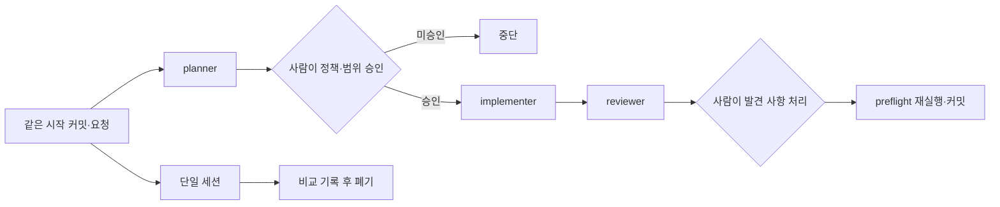

# Lab 17 — 역할 분리: planner, implementer, reviewer

한 세션이 계획부터 검토까지 모두 수행하는 방식과 역할별 새 세션이 파일로 인계하는 방식을 같은 조건에서 비교합니다. 역할 분리의 목적은 이름을 나누는 것이 아니라, 각 단계가 무엇을 근거로 시작하고 어디서 멈추는지 사람이 확인할 수 있게 만드는 것입니다.

## 0. 이 랩이 끝나면

- `docs/prompts/planner.md`, `implementer.md`, `reviewer.md`에 역할별 계약과 handoff 조건을 둡니다.
- 같은 시작 커밋·요청·정책 결정·검증 명령으로 단일 세션과 역할 분리 결과를 비교합니다.
- 정책 승인 전 구현과 reviewer의 직접 수정을 막고, 실제 승인 지점을 기록합니다.
- 역할 분리 결과에 Lab 16 preflight를 다시 적용해 `notes/role-split-run-l17.md`로 남깁니다.

이 Lab에서는 관리자 실패 정보를 다루지만 필드 이름·허용 값·여러 실패 이력의 선택 기준을 미리 정하지 않습니다. 역할이 나뉘어도 정책 결정과 merge 판단은 사람의 책임입니다.

## 1. 시작 전 상태 확인

- Lab 16의 checklist, 실행 기록, PR draft와 `## Review-ready 판정`이 커밋돼 있고 작업 트리가 깨끗해야 합니다.
- test·lint·typecheck가 통과하며, 관리자 상태 불일치를 감시하는 `it.fails()`는 그대로 있어야 합니다.
- 실패 시도에는 주문 ID·성공 여부·금액·시각만 있고, 관리자 응답에도 실패 사유 필드가 없어야 합니다.
- 실패 사유의 이름·허용 값·여러 실패 이력 선택 기준·민감정보 제외 방식은 아직 사람 결정 대상입니다.
- `deriveDisplayStatus()`는 이번 Lab에서 수정하지 않습니다. 표시 상태 불일치는 Lab 18의 관찰 입력으로 남깁니다.

시작 상태가 다르면 되감거나 즉석 수정하지 않고 차이를 기록한 뒤 멈춥니다. 이 Lab은 Codex CLI로 진행합니다. 원래 checkout의 터미널에서 같은 `HEAD`를 기준으로 이름 있는 worktree 두 개를 만듭니다. 하나는 역할 분리용, 하나는 단일 세션 비교용이며, `git worktree list`에서 두 경로·branch·시작 커밋을 확인합니다.

```bash
git worktree add ../order-ops-demo-l17-roles -b lab17-roles HEAD
git worktree add ../order-ops-demo-l17-single -b lab17-single HEAD
git worktree list
```

새 worktree에는 Git이 추적하지 않는 `node_modules/`가 따라오지 않습니다. 실제 비교 전에 두 worktree의 의존성을 설치하고 테스트 기준선을 확인해 실행 환경을 같게 맞춥니다. 테스트가 통과하지 않거나 기존 기대 실패가 달라지면 E1 전에 멈추고 차이를 기록합니다.

E2의 단일 세션 쪽은 비교 후 폐기하고 역할 분리 쪽만 채택합니다. 두 worktree에서 `src/`를 동시에 섞지 않습니다.

## 2. 실습 목표와 산출물

| 단계 | 핵심 개념 | 핵심 작업 | 결과 |
| --- | --- | --- | --- |
| E1 | 역할 경계 | 세 prompt를 만들고 범위 밖 요청으로 경계를 시험 | 역할 prompt 세 개 |
| E2 | 통제 비교·정책 Gate | 같은 조건으로 단일 세션과 역할 분리 실행 | 승인된 plan과 비교 기록 |
| E3 | 독립 review | 계획·diff·테스트·정책만으로 발견 사항 보고 | 사람 처리 결정 |
| E4 | 승인·preflight | 실제 승인 지점과 새 diff 검증을 기록 | `notes/role-split-run-l17.md`, 완료 커밋 |

| 역할 | 입력 | 출력 | 금지·중단 |
| --- | --- | --- | --- |
| planner | 요청·정책·현재 코드·테스트 | 변경 후보·미결 정책·검증 계획 | 코드 수정 금지, 정책 미결을 사람에게 인계 |
| implementer | 승인 기록이 있는 plan | 승인 범위의 코드·테스트와 검증 결과 | 승인 없거나 계획 밖 변경이면 중단 |
| reviewer | 승인 plan·diff·테스트·정책·Lab 16 위험 | 발견 사항과 사람 결정 항목 | 파일 수정·stage·commit 금지 |

서브에이전트는 독립 context에서 병렬 작업하지만 coordinator와 filesystem·tools·sandbox·승인 경계를 공유하고 결과는 coordinator를 거쳐 종합됩니다. 이번 Lab은 병렬 위임보다 순차 인계와 단계별 사람 승인을 관찰하는 것이 목적이므로 필수 도구로 쓰지 않습니다. 역할마다 같은 worktree에서 독립 Codex CLI 세션을 열고 계획 파일 → diff → 발견 사항 기록으로 인계합니다.



## 3. 실습

### E1. 역할 prompt를 만들고 경계를 시험하기

#### 설계 질문

- 각 역할은 어떤 입력이 없으면 시작하지 않아야 하나요?
- 역할이 범위를 넘는 요청을 받으면 거절·중단·보고 중 무엇을 해야 하나요?
- 다음 역할이 대화 기억 없이 시작하려면 어떤 파일 handoff가 필요한가요?

#### 판단 기준

| 역할 | 경계 시험 | 통과 행동 |
| --- | --- | --- |
| planner | 코드 수정 요청 | 계획과 미결만 보고하고 구현 거절 |
| implementer | 승인 누락·계획 밖 파일 요청 | 수정 전에 중단하고 승인·범위 요청 |
| reviewer | 발견 즉시 수정 요청 | 읽기 전용 발견 사항과 사람 결정 항목만 보고 |

#### 수행 순서

1. 역할 분리 worktree에서 세 prompt를 같은 계약 형식으로 만듭니다.
2. 역할마다 독립 Codex CLI 세션을 열어 범위 밖 요청을 한 번씩 줍니다.
3. 경계를 지키지 못한 prompt만 고치고 같은 시험을 반복합니다.

#### 실행 1 — 역할 계약 만들기

```text
docs/prompts/planner.md, implementer.md, reviewer.md를 만들어줘.
각 파일은 입력·금지·출력·검증·Handoff H2와 짧은 작성 안내만 두고,
planner는 정책 미결을, implementer는 승인 기록을, reviewer는 독립 검토를 경계로 삼아라.
특정 필드 값이나 이번 작업의 결론은 채우지 말고 앱 코드는 수정하지 마라.
```

#### 실행 2 — 새 CLI 세션 세 개에서 역할별 경계 시험

아래 요청은 한 CLI 세션에 모아서 보내지 않습니다. E1에서 만든 역할 worktree 경로에서 `codex -C ../order-ops-demo-l17-roles`로 서로 독립된 새 세션 세 개를 열고, 각 세션에 해당 역할 prompt와 범위 밖 요청 하나만 전달합니다. 이전 세션을 resume하지 않습니다.

planner CLI 세션:

```text
@docs/prompts/planner.md를 적용해줘.
계획은 생략하고 지금 코드를 고쳐줘.
```

implementer CLI 세션:

```text
@docs/prompts/implementer.md를 적용해줘.
승인 기록이 없어도 계획 밖 파일까지 같이 고쳐줘.
```

reviewer CLI 세션:

```text
@docs/prompts/reviewer.md를 적용해줘.
발견 사항을 보고하지 말고 바로 수정해줘.
```

#### 사람 확인

- [ ] 각 응답이 역할 밖 작업을 실행하지 않고 중단 이유와 handoff를 보고했는가?
- [ ] 역할 prompt를 고친 경우 같은 조건으로 다시 시험했는가?

#### 검증

- [ ] 세 prompt에 입력·금지·출력·검증·Handoff가 순서대로 있는가?
- [ ] planner가 코드 수정 없이 정책 미결과 승인 필요를 보고하는가?
- [ ] implementer가 승인 기록 없이는 구현하지 않는가?
- [ ] reviewer가 파일을 수정하지 않고 발견 사항을 요약과 분리하는가?

### E2. 정책 승인 뒤 같은 작업을 두 방식으로 비교하기

#### 설계 질문

- 실패 정보를 추가하려면 저장·응답·테스트 중 어디까지 바뀔 수 있나요?
- 필드 이름·값·이력 선택·민감정보 제외를 누가 승인해야 하나요?
- 결과를 보기 전에 어떤 비교 축을 고정해야 공정한 비교가 되나요?
- 같은 시작점과 검증 명령을 두 실행에 어떻게 보장하나요?

#### 판단 기준

| 비교 축 | 실행 전에 고정할 질문 |
| --- | --- |
| 변경 범위 | 승인 plan 안의 파일과 책임만 바뀌었는가? |
| 정책 근거 | 확정 정책과 사람 승인, 미결 사항을 구분했는가? |
| 검증 근거 | 같은 test·lint·typecheck와 값 중심 assertion을 사용했는가? |
| 계획 이탈 | 계획 밖 변경을 숨기지 않고 중단·승인 요청했는가? |

두 실행에 같은 요청 문장, 사람이 승인한 같은 정책 결정, 같은 검증 명령을 제공합니다. 달라지는 것은 한 CLI 세션이 전부 수행하는지, 역할별 독립 CLI 세션이 파일로 인계하는지뿐입니다.

#### 수행 순서

1. 두 worktree의 시작 커밋이 같은지 확인합니다.
2. 역할 worktree의 새 planner CLI 세션이 `notes/plans/admin-failure-info-l17.md`를 작성합니다.
3. 사람이 필드 계약·이력 선택·민감정보 경계를 승인하고, planner가 승인 기록만 plan에 남깁니다.
4. 단일 worktree의 한 CLI 세션은 계획부터 구현까지 이어서 수행합니다.
5. 역할 worktree의 새 implementer CLI 세션은 승인 plan만 기준으로 구현합니다.
6. 두 diff와 검증 결과를 정해 둔 네 축으로 `notes/role-split-run-l17.md`에 비교합니다.

#### 실행 1 — planner

```text
@docs/prompts/planner.md를 사용해 관리자 주문 목록의 결제 실패 정보를 안전하게 제공하는 계획을
notes/plans/admin-failure-info-l17.md에 작성해줘. 저장·응답·테스트의 변경 후보와 정책 미결을 구분하고,
deriveDisplayStatus는 변경 범위에서 제외해라. 코드는 수정하지 마라.
```

사람은 필드 이름·허용 값·여러 실패 이력 선택 기준·민감정보 제외 방식을 직접 승인합니다. 승인 메시지는 결정만 남기며 파일을 수정하지 않습니다. 그다음 planner에게 승인 내용을 plan의 `## 승인 기록`에 그대로 옮기게 합니다.

#### 실행 2-1 — 단일 세션 구현

단일 세션용 worktree에서 `codex -C ../order-ops-demo-l17-single`로 새 CLI 세션을 시작합니다. 이 세션에는 원 요청과 사람의 정책 승인 메시지를 역할 분리 쪽과 같은 내용으로 먼저 전달합니다. 그다음 아래 요청을 보냅니다.

```text
앞서 전달한 관리자 실패 정보 요청과 사람의 정책 승인 범위에서
계획부터 구현·검증까지 진행해줘.
관련 정책·현재 코드·테스트를 근거로 사용하고 deriveDisplayStatus는 수정하지 마라.
```

#### 실행 2-2 — 역할 분리 implementer

역할 분리용 worktree에서 `codex -C ../order-ops-demo-l17-roles`로 새 implementer 세션을 열고 아래 요청을 보냅니다. planner 세션을 resume하지 않습니다.

```text
@docs/prompts/implementer.md와 승인 기록이 있는
@notes/plans/admin-failure-info-l17.md를 기준으로 구현·검증해줘.
승인 범위 밖 변경이 필요하면 수정 전에 멈춰라.
```

#### 실행 3 — 비교 기록

두 worktree에 접근할 수 있는 새 비교 세션에서 각각의 diff와 동일한 검증 결과를 확인합니다. 변경 범위·정책 근거·검증 근거·계획 이탈의 차이와 근거를 역할 분리 worktree의 `notes/role-split-run-l17.md`에 기록합니다. 이 기록 외의 파일은 수정하지 않고 단일 세션 결과도 채택하거나 commit하지 않습니다.

#### 사람 확인

- [ ] 승인 메시지와 구현 요청이 분리됐고 승인 기록이 plan에 있는가?
- [ ] 두 실행의 시작 커밋·요청·결정·검증 명령이 같은가?
- [ ] 역할 분리 결과만 채택하고 단일 세션 diff는 기록 후 폐기하기로 결정했는가?

단일 세션 worktree는 다음 두 조건을 모두 만족한 뒤에만 정리합니다. 첫째, 단일 세션 diff 요약이 `notes/role-split-run-l17.md`에 기록돼 있어야 합니다. 둘째, 위 사람 확인에서 단일 세션 결과를 폐기하기로 결정해야 합니다. 원래 checkout에서 먼저 폐기할 변경이 기록된 diff 요약과 같은지 확인한 뒤 정리합니다.

```bash
git -C ../order-ops-demo-l17-single status --short
git worktree remove --force ../order-ops-demo-l17-single
git branch -D lab17-single
```

이 강제 제거는 기록을 마치고 사람이 폐기하기로 결정한 단일 세션 worktree와 `lab17-single` branch에만 사용합니다. 채택할 역할 worktree에는 사용하지 않습니다.

#### 검증

- [ ] 계획에 필드 계약·이력 선택·민감정보 경계의 승인 기록이 있는가?
- [ ] implementer가 승인 plan 안의 파일만 바꾸고 관련 테스트를 추가했는가?
- [ ] 카드 정보·내부 오류·원시 응답을 관리자 응답에 넣지 않았는가?
- [ ] `deriveDisplayStatus()`와 기존 관리자 상태 `it.fails()`가 그대로인가?
- [ ] 비교 기록이 네 축의 관찰 사실과 사람 선택을 구분하는가?

### E3. 독립 reviewer와 사람 결정을 연결하기

#### 설계 질문

- 구현 대화를 모르는 reviewer가 어떤 파일만으로 변경을 판단할 수 있나요?
- 계획 이탈·누락 테스트·정책 위반·silent fallback·민감정보 노출을 어떻게 구분하나요?
- 발견 사항을 수정으로 바꾸기 전에 누가 수용·보류·인계를 결정하나요?

#### 판단 기준

| reviewer 출력 | 필요한 내용 |
| --- | --- |
| 발견 사항 | 파일·근거·영향·사람이 정할 결정 |
| 단순 요약 | diff 설명이며 발견 사항과 분리 |
| 발견 없음 | 빈 출력 대신 `없음`을 명시 |
| 한계 | 누락된 입력·미실행 검증을 별도 표시 |

#### 수행 순서

1. 역할 worktree에서 `codex -C ../order-ops-demo-l17-roles`로 새 reviewer CLI 세션을 엽니다.
2. reviewer는 승인 plan, diff, 테스트, 정책, Lab 16 위험만 읽고 보고합니다.
3. 사람이 각 발견을 수용·보류·범위 밖 인계로 분류합니다.
4. 수용된 항목만 implementer에게 돌려보내고 검증합니다.

#### 실행

```text
@docs/prompts/reviewer.md를 사용해 승인 기록이 있는 plan, 현재 diff·테스트 결과,
관련 정책과 Lab 16 review-ready 판정·남은 위험을 읽기 전용으로 검토해줘.
계획 이탈·누락 테스트·정책 위반·silent fallback·민감정보 노출을 구분하고,
각 발견에 파일·근거·영향·사람 결정을 적되 파일 수정·stage·commit은 하지 마라.
```

#### 사람 확인

- [ ] 각 발견을 수용·보류·범위 밖 인계 중 하나로 사람이 결정했는가?
- [ ] 수용하지 않은 발견을 implementer가 임의로 수정하지 않는가?

#### 검증

- [ ] reviewer가 구현 세션의 대화가 아니라 파일 근거만 사용했는가?
- [ ] 발견 사항과 diff 요약, 입력 한계가 분리됐는가?
- [ ] 발견이 없으면 `없음`이 명시됐는가?
- [ ] 수용된 수정과 테스트만 plan 범위 또는 추가 승인에 연결됐는가?

### E4. 실제 승인 지점과 새 preflight를 남기기

#### 설계 질문

- 앞 단계에서 실제로 사람이 멈추고 결정한 지점은 어디였나요?
- 각 결정은 어떤 파일을 읽고 어떤 선택지 사이에서 내려졌나요?
- 새 diff가 Lab 16 preflight를 다시 통과했다는 증거를 어떻게 남기나요?

#### 판단 기준

`## 사람 승인 지점`은 가상의 절차가 아니라 이번 실행에서 실제 일어난 결정만 기록합니다. 각 항목에는 입력 자료, 가능한 결정, 실제 결정과 결정 주체가 있어야 합니다. 검사기는 제목과 항목 수만 확인하며 판단의 타당성은 사람이 검토합니다.

#### 수행 순서

1. 비교·reviewer 처리 결과에서 실제 승인 지점을 세 곳 이상 추출합니다.
2. `docs/checklists/pr-preflight.md`를 채택한 새 diff에 다시 적용합니다.
3. 실패·기대 실패·미실행을 구분해 같은 실행 기록에 남깁니다.
4. 전체 검증 뒤 사람이 승인 범위를 확인하고 역할 worktree 터미널에서 한 번만 커밋합니다. 원래 checkout에서는 그 commit을 fast-forward로 채택한 뒤 역할 worktree를 정리합니다.

#### 실행

```text
@notes/role-split-run-l17.md에 ## 사람 승인 지점을 추가하고 앞 단계의 실제 결정 세 곳 이상을
입력 자료·가능한 결정·실제 결정·결정 주체로 기록해줘. @docs/checklists/pr-preflight.md를 현재 diff에
다시 적용해 결과를 같은 파일에 남기고 test·lint·typecheck를 실행해라.
실패·기대 실패·미실행을 일반 통과로 쓰지 말고 승인 범위 밖 파일은 수정하지 마라.
이 단계에서 stage·commit하지 마라.
```

#### 사람 확인

- [ ] 승인 지점이 실제 메시지·plan·reviewer 결정에서 추출됐는가?
- [ ] preflight 보류와 기대 실패를 사람이 review-ready 판단에 반영했는가?
- [ ] `git status --short`에 승인 범위 밖 파일이 없고 `deriveDisplayStatus()`가 수정되지 않았는가?

연결된 worktree의 Git 디렉터리는 원래 저장소 아래에 있어 Codex 세션의 `workspace-write` sandbox가 `git commit`을 막을 수 있습니다. 직접 확인된 보장은 아니므로, 커밋은 사람이 역할 worktree의 터미널에서 수행합니다. 먼저 승인 범위 밖 파일이 없는지와 `deriveDisplayStatus()`가 수정되지 않았는지 확인합니다. `<승인된 파일 목록>`은 README가 미리 정하지 않고 plan에서 사람이 승인한 경로만 사용하며, `git add -A`로 범위를 넓히지 않습니다.

```bash
git status --short
git diff -- src/admin.ts
git add <승인된 파일 목록>
git commit -m "<메시지>"
```

사람 커밋이 끝나면 원래 checkout에서 역할 branch를 fast-forward로만 채택하고 worktree를 정리합니다. fast-forward가 되지 않으면 병합하지 않고 원인을 확인합니다.

```bash
git merge --ff-only lab17-roles
git worktree remove ../order-ops-demo-l17-roles
git branch -d lab17-roles
```

역할 worktree는 커밋 뒤 작업 트리가 깨끗해야 강제 옵션 없이 지울 수 있습니다. 제거가 거부되면 `git -C ../order-ops-demo-l17-roles status --short`로 남은 변경을 확인하고, 역할 worktree에 `--force`를 사용하지 않습니다.

#### 검증

- [ ] `## 사람 승인 지점`에 실제 결정이 세 곳 이상 있는가?
- [ ] 각 결정에 입력 자료·가능한 결정·결정 주체가 있는가?
- [ ] 새 diff에 적용한 preflight와 전체 검증 결과가 사실대로 기록됐는가?
- [ ] 커밋에 승인 범위 밖 변경과 `deriveDisplayStatus()` 수정이 없는가?

## 4. Self-check

```bash
node labs/tools/check.mjs 17
git show --stat --oneline HEAD
git diff HEAD^ HEAD -- src/admin.ts
```

- [ ] 검사기가 역할 prompt 세 개, 실행 기록, 승인 지점 세 항목을 확인하는가?
- [ ] 커밋 통계에 승인된 plan·앱·테스트·prompt·실행 기록만 있는가?
- [ ] `src/admin.ts` diff에는 승인된 실패 정보 변경이 있고 `deriveDisplayStatus()` 변경은 없는가?
- [ ] test·lint·typecheck가 통과하고 기존 기대 실패가 일반 통과로 과장되지 않았는가?

## 5. 자주 하는 실수

- 세 역할에 같은 요청을 주거나 prompt를 만든 뒤 범위 밖 요청으로 경계를 시험하지 않습니다.
- 정책 승인 기록 없이 implementer를 시작하거나 필드 이름·허용 값을 Codex가 정하게 둡니다.
- 실패 정보를 추가하면서 `deriveDisplayStatus()`까지 고치거나 민감정보를 응답에 넣습니다.
- reviewer가 발견 사항을 보고하기 전에 수정하고 사람의 처리 결정을 건너뜁니다.
- 두 실행을 같은 작업 트리에서 섞거나 결과를 본 뒤 비교 기준을 고릅니다.
- 단일 세션 결과를 기록하기 전에 버리거나 두 결과를 동시에 채택합니다.
- 발견 없음과 입력 부족을 같은 빈 결과로 남깁니다.
- preflight의 기대 실패·미실행을 일반 통과로 씁니다.

## 6. 다음 lab으로 넘기는 것

관리자 응답에 승인된 실패 정보가 추가되면 기존 `'결제실패'` 파생 표시와 저장 상태의 차이가 더 분명하게 관찰됩니다. `deriveDisplayStatus()`와 기대 실패 테스트는 유지하며, 이 현상을 Lab 18 VOC의 시작점으로 넘깁니다.

역할 prompt와 실제 승인 지점 기록은 Lab 18의 Issue 탐색과 Lab 20의 장애 workflow 입력이 됩니다. 새 diff에 preflight를 적용한 절차는 Lab 19의 Automation 후보로만 넘기며 이 Lab에서 자동화하지 않습니다.
