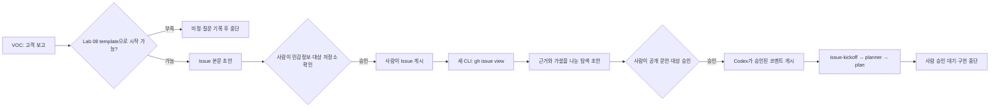

# Lab 18 — GitHub Issue를 유일한 요청 원문으로 사용하기

Lab 08에서 만든 Issue template을 실제 GitHub Issue에 적용하고, 로컬 Codex CLI가 그 Issue를 읽어 탐색한 뒤 planner에게 넘길 근거를 만듭니다. 이번 Lab의 종료점은 구현이 아니라 **Issue → 탐색 → plan → 사람 승인 대기**입니다.

## 0. 이 랩이 끝나면

- VOC가 아니라 사람이 검토해 게시한 GitHub Issue를 작업의 유일한 요청 원문으로 사용합니다.
- Issue 본문 초안은 Codex가 파일로 만들고, 민감정보와 미정 항목을 사람이 확인한 뒤 직접 게시합니다.
- 새 CLI 세션이 `gh issue view`로 Issue를 읽고 근거와 가설을 분리한 탐색 코멘트 초안을 만듭니다.
- `docs/prompts/issue-kickoff.md`를 Lab 17의 planner 앞에 연결하고 구현 전 승인 Gate를 유지합니다.

여기서 “Issue에서 시작”은 GitHub가 Issue를 Codex 작업으로 자동 전환한다는 뜻이 아닙니다. Codex 제품의 GitHub 연동 문서가 설명하는 주요 흐름은 PR review입니다. OpenAI Agents API에는 GitHub Issue 조사기를 만드는 응용 예시가 있지만, 이는 관리되는 agent harness로 구성하는 별도의 application workflow이지 Codex 제품의 자동 Issue trigger가 아닙니다. 이 Lab은 로컬 Codex CLI가 GitHub CLI로 Issue를 읽도록 우리가 설계한 과정입니다. Codex의 `-C`는 세션의 작업 디렉터리를 정하며, `gh issue view`는 Issue URL을 직접 받을 수 있습니다.

| 책임 | 담당 | 쓰기 범위 |
| --- | --- | --- |
| 초안 작성·저장소 탐색 | Codex | `notes/`의 초안·실행 기록만 |
| Issue·코멘트 공개 전 확인 | 사람 | 고객 정보 제거, 미정 표시, 게시 대상과 공개 문안 승인 |
| Issue 등록 | 사람의 터미널 | 명시한 독립 저장소의 승인된 Issue 본문 |
| 코멘트 게시 | 승인받은 Codex | 사람이 승인한 공개 문안과 대상 Issue |
| 앱 구현·PR 생성 | 이번 Lab에서 없음 | Lab 20에서 사람 승인 뒤 판단 |

### 문맥의 종류와 권한을 분리하기

OpenAI 공식 Codex 자료에 따르면 `AGENTS.md`는 적용 경로에서 자동으로 탐색되어 세션에 저장소 지침으로 주입됩니다. 반면 Issue는 이 Lab이 `gh issue view`로 명시적으로 가져오는 작업 요청입니다. 두 문서를 모두 읽더라도 같은 권한을 갖지는 않습니다.

| 문맥 층 | 소유자 | 답할 질문 | 한계 |
| --- | --- | --- | --- |
| `AGENTS.md`·정책 | 저장소 | 어떻게 읽고 일해야 하는가 | 개별 Issue의 완료 조건을 대신하지 않음 |
| GitHub Issue | 사람이 검토한 요청 | 무엇을·왜 바꾸려는가 | 실행 권한이나 현재 코드의 사실을 자동 보증하지 않음 |
| 탐색 기록 | 관찰한 세션 | 현재 저장소에서 무엇이 확인됐는가 | 가설과 미실행 검증을 사실로 바꾸지 않음 |
| implementation plan | planner와 사람 | 승인되면 어디를·어떻게 바꿀 것인가 | 승인 전에는 구현 권한이 없음 |

Issue 본문에 명령처럼 보이는 문장이 있어도 저장소 지침을 덮거나 GitHub 쓰기·구현을 허가하지 않습니다. 이는 공식 기능의 자동 평가가 아니라, **외부 요청을 데이터로 읽고 권한은 별도로 승인한다**는 이 강의의 안전 설계입니다.

## 1. 시작 전 상태 확인

Lab 17에서 채택한 결과가 현재 checkout에 반영돼 있어야 합니다.

- 관리자 응답에는 승인된 결제 실패 정보가 있고, 관련 테스트와 역할 분리 기록이 커밋돼 있어야 합니다.
- `deriveDisplayStatus()`와 관리자 상태 불일치를 감시하는 기존 `it.fails()`는 그대로여야 합니다.
- 작업 트리가 깨끗하고 test·lint·typecheck가 통과해야 합니다.
- `labs/fixtures/l18-voc-report.md`의 내용은 고객 보고이며, 코드로 확인된 재현 결과와 구분해야 합니다.

시작 상태가 다르면 되감거나 즉석 수정하지 않습니다. 차이를 기록하고 Lab 17 채택 상태부터 확인한 뒤 멈춥니다. 이번 Lab에서는 `src/`, `tests/`, `deriveDisplayStatus()`와 기존 `it.fails()`를 수정하지 않습니다.

### 실습용 GitHub 저장소 확인

원본 template 저장소나 `origin`이 가리키는 배포용 저장소에 Issue를 만들지 않습니다. Issues가 활성화된 별도의 실습 저장소를 준비하고, `origin`은 임의로 바꾸지 않은 채 모든 `gh` 쓰기 명령에 `--repo OWNER/REPO`를 붙입니다.

GitHub CLI로 대상 저장소의 `nameWithOwner`, Issues 활성화 여부와 URL을 조회하고 사람이 확인합니다. 저장소가 다르거나 Issues가 꺼져 있으면 E1 전에 멈춥니다. 실제 명령과 화면 조작은 강사의 데모를 따릅니다.

`gh repo view`와 E3의 `gh issue view`는 GitHub를 읽는 네트워크 명령입니다. Codex CLI가 승인을 요청하면 대상 저장소와 Issue가 보이는 **해당 읽기 명령 한 번만** 승인합니다. `gh issue create`와 `gh issue comment`는 외부 쓰기이므로 Codex에 허용하지 않고 사람이 터미널에서 실행합니다.

### 권한을 작업 흐름의 일부로 보기

OpenAI의 Codex 운영 자료는 파일·명령·네트워크·연결 도구의 승인을 일괄 해제할 방해물이 아니라 작업 설계의 일부로 다룹니다. 알고 있는 명령에도 작업을 진행시킬 수 있는 가장 좁은 권한을 고르는 것이 원칙입니다.

| 행동 | 효과 경계 | 이 Lab의 승인 |
| --- | --- | --- |
| `gh repo view`, `gh issue view` | 외부 상태를 읽지만 변경하지 않음 | 대상을 보고 해당 읽기 명령만 승인 |
| `notes/`에 초안 저장 | 로컬 작업 트리를 변경 | 승인된 산출물 경로만 허용하고 diff 확인 |
| `gh issue create` | 외부 GitHub 상태를 변경 | 본문과 대상 저장소를 확인한 사람이 직접 실행 |
| `gh issue comment` | 외부 GitHub 상태를 변경 | 사람이 공개 문안·대상·효과를 명시적으로 승인한 뒤 Codex가 실행 |
| `src/`, `tests/` 수정 | 제품 동작과 검증 범위를 변경 | 이 Lab에서 금지 |

승인은 제안된 **명령·대상·효과**를 보고 내립니다. 읽기 승인이 GitHub 쓰기까지 허가하지 않고, 한 Issue 조회 승인이 다른 저장소 조회를 자동으로 허가하지도 않습니다.

## 2. 실습 목표와 산출물

| 단계 | 핵심 작업 | 결과 |
| --- | --- | --- |
| E1 | VOC를 Lab 08 template으로 합격 판정 | `notes/issue-run-l18.md`의 판정 기록 |
| E2 | Issue 초안 작성·사람 확인·직접 등록 | `notes/issue-draft-l18.md`, Issue URL·게시 기록 |
| E3 | URL 기반 탐색·입력 방식 비교·사람 승인 후 게시 | `notes/issue-findings-l18.md`, 코멘트 게시 기록 |
| E4 | Issue kickoff 계약을 적용해 planner 승인 대기까지 연결 | `docs/prompts/issue-kickoff.md`, plan, 완료 커밋 |

`notes/issue-run-l18.md`는 `## E1 Issue 합격 판정`, `## E2 Issue 등록 기록`, `## E3 탐색·코멘트 게시 기록`, `## E4 Handoff 기록`을 순서대로 두고 각 단계의 관찰과 사람 판단을 이어서 남깁니다.



Issue는 단순 링크가 아니라 요청 변경의 정본입니다. 이후 탐색과 plan은 VOC 원문이나 이전 대화가 아니라 사람이 검토한 Issue의 제목·본문·후속 코멘트를 다시 읽어야 합니다.

## 3. 실습

### E1. 이 Issue만 보고 작업을 시작할 수 있는지 판정하기

#### 설계 질문

- 고객이 보고한 사실과 저장소에서 확인한 사실이 구분돼 있나요?
- Lab 08의 아홉 필드 중 작업 시작에 필요한 정보가 비어 있나요?
- 빠진 값은 조사로 확인할 사실인가요, 사람이 결정할 정책인가요?
- 완료 기준과 검증 방법이 구현 전에 판정 가능한가요?

#### 판단 기준

| 판정 축 | 합격 신호 | 중단 신호 |
| --- | --- | --- |
| 요청 원문 | 보고 사실과 미확인 주장이 구분됨 | 추정을 현재 동작으로 단정함 |
| 범위 | Scope와 Out of Scope가 충돌하지 않음 | 무엇을 고칠지 경계가 없음 |
| 결정 | 미정 정책이 Human Decision Needed에 있음 | Codex가 빈 값을 선택해야 시작 가능함 |
| 완료 | Acceptance Criteria와 검증 근거가 연결됨 | “정상화”처럼 결과를 판정할 수 없음 |

E1은 Lab 08의 나쁜 Issue 진단을 반복하지 않습니다. 이미 만든 template을 **합격 기준**으로 사용해, 이 요청을 탐색 단계까지 진행할지 아니면 질문으로 돌려보낼지만 판단합니다.

#### 수행 순서

1. VOC와 template을 대조하고 보고·확인·결정 필요를 구분합니다.
2. 정책·현재 코드·테스트로 확인 가능한 범위만 조사합니다.
3. 합격·조건부 합격·중단과 그 근거를 `notes/issue-run-l18.md`의 E1 절에 기록합니다.

#### 실행

```text
목표: 이 VOC만으로 저장소 탐색을 시작할 수 있는지 Lab 08 Issue template 기준으로 판정한다.
문맥: @labs/fixtures/l18-voc-report.md, @.github/ISSUE_TEMPLATE/workflow-task.md, 관련 정책·현재 코드·테스트를 사용한다.
제약: 원인·수정안·응답 필드를 추측하거나 앱 코드와 테스트를 수정하지 않는다.
완료 조건: 보고 사실·확인 사실·사람 결정·누락을 구분하고 판정과 근거를 @notes/issue-run-l18.md의 E1 절에 기록한다.
```

#### 사람 확인

- [ ] 고객의 표현을 코드로 검증된 사실처럼 바꾸지 않았는가?
- [ ] 기존 정책으로 답할 항목을 새 정책 질문으로 만들지 않았는가?
- [ ] 원인이나 변경 파일을 합격 조건에 미리 넣지 않았는가?

#### 검증

- [ ] 아홉 필드 각각이 충분·확인 필요·사람 결정·누락 중 하나로 판정됐는가?
- [ ] 합격 여부와 중단 이유가 원문·정책·코드 근거에 연결됐는가?
- [ ] 구현이 아니라 Issue 초안 작성 가능 여부까지만 판정했는가?
- [ ] `src/`와 `tests/`가 수정되지 않았는가?

#### 흔한 실패와 대응

VOC와 현재 코드가 어긋난다고 곧바로 원인을 확정하지 않습니다. 고객 보고는 보존하고, 재현되지 않거나 정책과 충돌하는 지점은 Issue의 확인 필요 또는 사람 결정으로 넘깁니다.

### E2. Issue 초안을 사람이 확인한 뒤 등록하기

#### 설계 질문

- 공개 Issue에서 제거할 고객 식별 정보·결제 토큰·카드 정보가 있나요?
- 확인하지 못한 내용이 사실 문장이나 완료 기준에 섞여 있나요?
- 게시 대상이 원본 template 저장소가 아닌 독립 저장소인가요?

#### 판단 기준

| 초안 요소 | 사람이 확인할 것 |
| --- | --- |
| Current Behavior | 고객 보고와 저장소 관찰을 출처와 함께 구분 |
| Expected Behavior | 정책 근거가 있거나 `미정`으로 표시 |
| Acceptance Criteria | 상태·응답·저장 결과·검증 증거로 판정 가능 |
| References | 정책·코드·fixture 경로만 연결하고 비밀값 제외 |

초안 작성과 외부 게시의 권한을 분리합니다. Codex는 로컬 파일까지만 쓰고, 사람은 body diff와 대상 저장소를 확인한 뒤 `gh`를 직접 실행합니다.

#### 수행 순서

1. E1 판정과 template으로 `notes/issue-draft-l18.md`를 만듭니다.
2. 사람이 민감정보 제거, `미정`, 완료 기준과 대상 저장소를 확인합니다.
3. 사람이 터미널에서 Issue를 게시하고 URL·게시 시각·직접 고친 지점을 실행 기록에 남깁니다.

#### 실행 1 — 초안 작성

```text
목표: E1 판정을 Lab 08 template에 맞춘 GitHub Issue 본문 초안으로 만든다.
문맥: @labs/fixtures/l18-voc-report.md, @.github/ISSUE_TEMPLATE/workflow-task.md, @notes/issue-run-l18.md와 확인한 근거를 사용한다.
제약: 고객 식별 정보·결제 토큰·카드 정보를 넣지 않고 미확인 값은 미정으로 두며 앱 코드와 테스트를 수정하지 않는다.
완료 조건: 아홉 영역이 있는 @notes/issue-draft-l18.md만 작성하고 게시하지 않는다.
```

#### 실행 2 — 사람이 게시

사람이 GitHub CLI에서 대상 저장소를 명시하고 `notes/issue-draft-l18.md`를 본문 파일로 사용해 Issue를 게시합니다. 게시 결과의 Issue URL과 등록 사실, 사람이 초안에서 수정한 지점을 `notes/issue-run-l18.md`의 E2 절에 이어서 기록합니다. 실제 게시 명령은 강사의 데모를 따릅니다.

#### 사람 확인

- [ ] `gh repo view`의 대상과 `--repo` 값이 같은 독립 저장소인가?
- [ ] 본문에 고객 식별 정보·결제 토큰·카드 정보가 없는가?
- [ ] 확인하지 못한 상태·응답·원인이 `미정`으로 보이는가?

#### 검증

- [ ] draft가 template의 아홉 영역과 판정 가능한 완료 기준을 갖는가?
- [ ] Issue URL과 게시 기록, 사람이 수정한 지점이 실행 기록에 있는가?
- [ ] GitHub에 게시된 본문이 사람이 확인한 local draft와 같은가?
- [ ] Codex 세션이 `gh issue create`를 실행하지 않았는가?

#### 흔한 실패와 대응

대상 저장소가 다르면 게시하지 않고 `gh repo view OWNER/REPO`부터 다시 확인합니다. 잘못된 저장소에 이미 게시했다면 다음 단계로 진행하지 말고 사람이 정리 여부와 기록 방식을 결정합니다. 문제를 숨기려고 `origin`을 바꾸지 않습니다.

### E3. 새 CLI 세션이 Issue URL만으로 탐색하기

#### 설계 질문

- 새 세션이 이전 대화 없이 Issue의 어떤 내용을 요청 원문으로 읽었나요?
- 코드로 확인한 근거와 아직 검증하지 않은 원인 가설이 분리됐나요?
- Issue URL과 VOC 원문 파일은 요청의 검토 상태와 포함하는 문맥에서 어떤 차이가 있나요?

#### 판단 기준

| 출력 구분 | 필요한 증거 |
| --- | --- |
| 확인된 사실 | 실제로 읽은 파일·위치와 관찰한 동작 |
| 원인 가설 | 가설 근거와 반증·추가 확인 방법 |
| 미정·충돌 | Issue·정책·코드가 답하지 못한 질문 |
| handoff | planner가 읽을 Issue URL·탐색 초안·중단 조건 |

URL은 사람이 검토한 요청의 정체성과 이후 코멘트 이력을 유지합니다. fixture는 version control에 남은 고객 보고 원문이지만 Issue에서 사람이 보완한 범위·완료 기준·후속 코멘트는 포함하지 않습니다. 두 결과는 답의 길이가 아니라 **어떤 원문을 읽었고 사람 검토가 탐색 입력에 어떻게 반영됐는가**로 비교합니다.

#### 정체성과 스냅샷은 다릅니다

Issue URL은 같은 요청을 다시 찾게 하는 **정체성**을 제공하지만, 본문과 코멘트는 수정될 수 있습니다. 따라서 재현 가능한 탐색 기록은 URL만이 아니라 읽은 시점의 `number`·`url`·`updatedAt`을 남깁니다. 이 메타데이터는 Issue 본문을 다른 문서에 복제하려는 것이 아니라, **어떤 버전의 요청을 읽었는지** 확인하기 위한 provenance marker입니다.

GitHub CLI는 Issue URL을 받고 선택한 JSON 필드를 출력할 수 있습니다. 새 Codex CLI 세션이 Issue의 번호·제목·본문·코멘트·URL·`updatedAt`을 읽는 명령을 제안하면, 사람은 대상과 필드가 맞는지 확인한 뒤 해당 읽기만 한 번 승인합니다. 사람이 이 조회 명령을 따로 입력하지 않습니다.

#### 수행 순서

1. `codex -C <실습 checkout 경로>`로 새 CLI 세션을 엽니다.
2. Issue URL만 전달하고 `gh issue view`로 Issue 본문·코멘트·`updatedAt`을 읽는 명령만 승인합니다.
3. 별도 새 세션에는 `labs/fixtures/l18-voc-report.md`만 요청 원문으로 주어 짧게 비교합니다.
4. URL 기반 결과를 `notes/issue-findings-l18.md`로 남기고, 별도의 공개용 코멘트를 사람이 승인한 뒤 Codex가 게시합니다.

#### 실행 1 — Issue URL 기반 탐색

```text
목표: <Issue URL>을 유일한 요청 원문으로 읽고 구현 전 탐색 결과를 작성한다.
문맥: gh issue view로 Issue를 읽고 저장소 지침·관련 정책·현재 코드·테스트를 따라간다.
제약: GitHub와 앱 파일을 수정하지 않고, 근거와 가설·미정을 분리하며 해결책을 확정하지 않는다.
완료 조건: Issue URL·updatedAt·읽은 경로·관찰 사실·가설과 확인 방법·planner handoff를 @notes/issue-findings-l18.md에 기록한다.
```

#### 실행 2 — VOC 원문 파일 비교

```text
목표: @labs/fixtures/l18-voc-report.md만 요청 원문으로 삼아 구현 전 탐색을 수행한다.
문맥: 저장소 지침·관련 정책·현재 코드·테스트를 읽고, 읽은 경로와 근거를 보고한다.
제약: GitHub Issue와 기존 탐색 결과를 읽지 않고, 파일과 GitHub를 수정하지 않으며 원인·수정안을 확정하지 않는다.
완료 조건: URL 기반 결과와 비교할 수 있게 요청 원문·확인 사실·가설·미정을 구분해 보고한다.
```

두 결과의 요청 원문, 사람이 고친 내용과 Issue 코멘트의 반영 여부, 근거 재확인 가능 여부를 `notes/issue-run-l18.md`의 E3 절에 기록합니다. `notes/issue-findings-l18.md`는 상세 탐색 기록으로 유지하고, 공개용 코멘트는 URL 기반 결과에서 별도로 작성합니다.

#### 실행 3 — 사람 승인 뒤 코멘트 게시

Codex가 URL 기반 탐색 결과에서 공개용 코멘트만 응답으로 제안합니다. 사람은 대상 저장소·Issue와 공개 문안을 확인해 명시적으로 승인하고, Codex는 승인된 문안 그대로 코멘트를 게시한 뒤 URL을 실행 기록에 남깁니다. 상세 탐색 기록 파일 전체를 코멘트 본문으로 사용하지 않으며, 실제 승인과 게시 과정은 강사의 데모를 따릅니다.

#### 사람 확인

- [ ] Codex가 실제로 실행하려는 명령이 대상 Issue의 읽기 전용 `gh issue view`인가?
- [ ] 코멘트 초안의 사실·가설·미정이 서로 섞이지 않았는가?
- [ ] 원인이나 변경 방향을 승인된 결론처럼 쓰지 않았는가?
- [ ] 사람이 공개 문안과 게시 대상을 승인한 뒤에만 Codex가 외부 쓰기를 수행하는가?

#### 검증

- [ ] 새 세션이 Issue 제목·본문을 `gh issue view`로 직접 읽었는가?
- [ ] Issue URL·number·updatedAt이 읽은 시점의 provenance로 기록됐는가?
- [ ] 각 확인 사실에 파일·위치 또는 명령 근거가 있는가?
- [ ] URL과 VOC 원문 파일 결과의 차이가 요청의 검토 상태·포함 문맥·추적성 기준으로 기록됐는가?
- [ ] 코멘트 URL·게시 기록·사람이 고친 지점이 실행 기록에 있는가?
- [ ] 앱 코드·테스트와 `deriveDisplayStatus()`가 수정되지 않았는가?

#### 흔한 실패와 대응

네트워크 승인이 거부되거나 인증이 없으면 Issue 본문을 대신 붙여 넣어 URL 기반 탐색이 성공했다고 기록하지 않습니다. `gh auth status`와 대상 저장소 접근을 사람이 확인하고, URL 기반 단계는 미실행으로 남깁니다.

### E4. Issue kickoff를 planner 앞에 연결하기

#### 설계 질문

- Issue URL 외에 요청 내용을 중복 저장하지 않고 planner에 무엇을 넘겨야 하나요?
- 어떤 불확실성에서 plan 작성을 멈추고 사람에게 물어야 하나요?
- plan과 PR draft의 위치를 어떻게 다음 단계가 찾게 하나요?

#### 판단 기준

| 계약 영역 | 책임 |
| --- | --- |
| 입력 | Issue URL, 저장소 지침, 탐색 근거와 출력 경로 |
| 금지 | Issue 밖 요구 추측, 구현, GitHub 쓰기, 정책 임의 결정 |
| 출력 | Issue에 연결된 plan과 미결·중단 이유 |
| 검증 | Issue·정책·현재 동작·plan 범위 대조 |
| Handoff | 사람 승인 뒤 planner/implementer, PR draft 위치로 연결 |

`issue-kickoff.md`는 이번 VOC의 해결 내용을 저장하는 문서가 아니라 다음 Issue에도 쓰는 계약입니다. Issue가 비공개이거나 읽히지 않음, 본문과 정책 충돌, 완료 기준 부재, 민감정보 발견, 사람 결정 필요가 stop condition이 됩니다.

OpenAI의 iterative workflow 예시는 `AGENTS.md`·plan·goal·prompt 문서를 사용하지만, `AGENTS.md` 외의 파일은 Codex가 요구하는 필수 규격이 아니라 작업에 맞춰 선택하는 workflow convention임을 명시합니다. 따라서 `issue-kickoff.md`는 planner의 내용을 복제하는 두 번째 계획 문서가 아니라, **Issue 확인·중단·handoff만 소유하는 작은 진입점**으로 제한합니다.

#### 수행 순서

1. Lab 17 planner의 입력·금지·출력·검증·Handoff 구조를 이어받습니다.
2. Issue URL을 유일한 요청 원문으로 두고 plan·PR draft 경로와 stop condition을 요구합니다.
3. 새 CLI 세션에서 kickoff와 planner를 실제 Issue에 적용해 plan을 만들고 사람 승인 전에 멈춥니다.
4. 실행 기록의 E4 handoff를 완성하고 전체 검증 뒤 문서 산출물만 커밋합니다.

#### 실행 1 — 재사용 prompt 작성

```text
목표: @docs/prompts/planner.md 앞에서 GitHub Issue를 검증·탐색하고 plan 승인 대기로 넘기는 재사용 prompt를 만든다.
문맥: @notes/issue-run-l18.md와 Lab 17 prompt 계약 형식을 사용한다.
제약: Issue URL만 요청 원문으로 삼고 GitHub 쓰기·구현을 금지하며 이번 VOC의 필드·원인·수정안을 넣지 않는다.
완료 조건: @docs/prompts/issue-kickoff.md에 입력·금지·출력·검증·Handoff와 plan·PR draft 경로, stop condition 안내가 있다.
```

#### 실행 2 — Issue에서 plan 승인 대기까지 시험

```text
목표: <Issue URL>을 유일한 요청 원문으로 삼아 구현 계획을 작성하고 사람 승인 전에 멈춘다.
문맥: @docs/prompts/issue-kickoff.md, @docs/prompts/planner.md, @notes/issue-findings-l18.md를 적용한다.
제약: gh issue view 외 GitHub 쓰기와 앱·테스트 수정을 금지하고 미결 정책은 질문으로 남긴다.
완료 조건: 정한 plan 경로와 PR draft handoff 위치를 기록하고 승인 대기 상태를 @notes/issue-run-l18.md의 E4 절에 남긴다.
```

#### 사람 확인

- [ ] Issue 본문을 prompt 안에 복제하지 않고 URL에서 다시 읽게 하는가?
- [ ] plan 승인 전 implementer로 넘어가지 않는가?
- [ ] PR draft는 생성하지 않고 handoff 위치만 요구하는가?

#### 검증

- [ ] 다섯 H2가 정해진 순서로 있고 각 책임이 구분되는가?
- [ ] Issue URL·plan 경로·PR draft handoff 위치·stop condition을 요구하는가?
- [ ] 이번 VOC의 필드 이름·원인 판단·수정 방향이 prompt에 없는가?
- [ ] plan이 Issue·탐색 근거에 연결되고 사람 승인 대기 상태에서 멈췄는가?
- [ ] `notes/issue-run-l18.md`에 E1~E4의 판정·URL·사람 수정·plan handoff가 이어지는가?
- [ ] 시작 커밋과 비교해 `src/`·`tests/` 변경이 없는가?

#### 흔한 실패와 대응

kickoff prompt가 Issue 내용을 다시 적거나 구현 단계를 포함하면 재사용 계약이 아닙니다. 경로와 중단 조건만 남기고, 이번 작업의 사실은 Issue·탐색 초안·실행 기록에 둡니다.

사람은 검증 뒤 문서 산출물만 명시적으로 stage하고 커밋합니다.

stage 대상은 kickoff prompt, Issue 초안, 탐색 기록, 실행 기록과 이번 plan으로 제한합니다. staged diff에 앱 코드·테스트가 없는지 사람이 확인한 뒤 Lab 18 문서 산출물 커밋으로 마무리합니다. 실제 Git 명령은 강사의 데모를 따릅니다.

## 4. Self-check

Lab 18 검사기를 실행하고, Lab 시작 커밋과 현재 상태 사이의 `src/`·`tests/` diff가 비어 있는지 확인합니다. 실제 검증 명령은 강사의 데모를 따릅니다.

- [ ] 검사기가 kickoff의 다섯 H2와 실행 기록의 E1~E4 절을 확인하는가?
- [ ] test·lint·typecheck가 통과하고 기존 `it.fails()`가 유지되는가?
- [ ] Issue와 코멘트가 같은 독립 저장소에 있으며 URL이 실행 기록에 있는가?
- [ ] 커밋에 `src/`·`tests/` 변경, 구현 또는 PR 생성이 없는가?

## 5. 자주 하는 실수

- Lab 08의 Issue 품질 진단을 반복하고 실제 URL 기반 읽기까지 가지 않습니다.
- 고객 보고를 재현 사실로 바꾸거나 토큰·카드·식별 정보를 Issue에 남깁니다.
- `--repo` 없이 게시해 원본 template 저장소에 Issue나 코멘트를 만듭니다.
- 탐색 근거와 원인 가설을 섞고, 사람 승인 전에 plan을 구현으로 넘깁니다.

## 6. 다음 lab으로 넘기는 것

Lab 19에는 Issue가 생긴 뒤 반복할 수 있는 **읽기 전용 후보**를 넘깁니다. 새 Issue의 정책·코드·테스트 후보 찾기, 탐색 근거 형식 확인, 미정·stop condition 감지는 Automation 후보가 될 수 있지만 GitHub 게시 여부와 정책 승인은 사람이 유지합니다.

Lab 20에는 같은 독립 저장소의 Issue URL, `notes/issue-findings-l18.md`, `notes/issue-run-l18.md`, `docs/prompts/issue-kickoff.md`, 승인 대기 중인 plan과 PR draft handoff 위치를 넘깁니다. Lab 20에서야 사람이 plan을 승인하고 구현·검증·PR 후보를 연결합니다.

참고: [Codex CLI command reference](https://developers.openai.com/codex/cli/reference/), [Codex Prompting Guide](https://developers.openai.com/cookbook/examples/gpt-5/codex_prompting_guide), [Iterating Development Workflows with Codex](https://developers.openai.com/cookbook/examples/codex/iterating-development-workflows-with-codex), [Codex permission workflow](https://developers.openai.com/blog/mastering-codex-remote-for-engineering), [Agents API overview](https://developers.openai.com/api/docs/guides/agents-api/overview), [Codex Code Review rules](https://developers.openai.com/blog/custom-code-review-rules-for-codex), [GitHub CLI issue create](https://cli.github.com/manual/gh_issue_create), [issue view](https://cli.github.com/manual/gh_issue_view), [issue comment](https://cli.github.com/manual/gh_issue_comment), [repo view](https://cli.github.com/manual/gh_repo_view)
