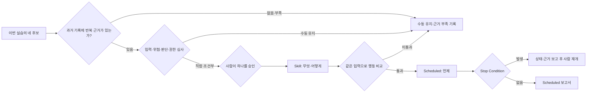

# Lab 19 — 반복 작업을 Skill과 Scheduled task로 연결하기

Lab 01~18에서 사람이 반복해 검증한 작업 하나를 repo Skill로 만들고, 그 Skill을 자동 실행 후보에 연결합니다. 새 자동화 기능을 먼저 고르는 Lab이 아니라, **이미 검증한 절차만 떼어내고 권한·중단 조건이 맞지 않으면 자동화하지 않는 Lab**입니다.

## 0. 이 랩이 끝나면

- 네 후보를 반복성·입력 안정성·실패 영향·사람 판단·자동 실행에 필요한 권한으로 판정합니다.
- `.agents/skills/<이름>/SKILL.md` 하나를 만들고, Scheduled 연결 전에 새 세션 행동 비교를 통과시킵니다.
- `docs/automation/candidates.md`, `docs/automation/stop-conditions.md`, `notes/automation-run-l19.md`를 남깁니다.
- Desktop의 Scheduled에서 task를 생성하되 실제 발화 성공은 주장하지 않습니다.

이 과정에서는 Skill이 **무엇을 어떻게 수행할지**, Scheduled task가 **언제 수행할지**를 소유하도록 나눕니다. 공식 문서는 Scheduled task와 Skill을 함께 쓸 수 있다고 설명하지만, 이 책임 분리는 이번 과정의 설계입니다.

| Skill: 작업 계약 | Scheduled: 실행 계약 |
| --- | --- |
| Input, Output | Run Condition |
| Stop Condition, Human Approval Needed | Failure Alert |

Scheduled task는 사람이 지켜보지 않는 상태에서 자동으로 실행되므로 중간 승인 대화를 이어갈 수 없다고 가정합니다. `Human Approval Needed`는 승인을 기다리며 계속 실행한다는 뜻이 아니라, **중단하고 Scheduled 보고서에 근거를 남긴 뒤 사람이 일반 세션에서 재개**한다는 뜻입니다. `Failure Alert`도 확인되지 않은 이메일·메신저 알림이 아니라 Scheduled 화면에서 검토할 보고 항목입니다.

Automation 후보는 편리해 보이는 작업이 아니라 **반복 가능하고, 경계가 있으며, 결과를 관찰할 수 있는 작업**입니다. 네 후보 모두를 같은 여섯 필드로 먼저 정의한 뒤, 실제 권한 시험을 통과하고 사람이 승인한 하나만 Skill과 Scheduled task로 승격합니다.

## 1. 시작 전 상태 확인

- Lab 18의 Issue·탐색 기록·`issue-kickoff.md`·승인 대기 plan이 커밋돼 있고 작업 트리가 깨끗해야 합니다.
- test·lint·typecheck가 통과하고 관리자 상태의 `it.fails()`와 `deriveDisplayStatus()`가 유지돼야 합니다.
- `docs/checklists/pr-preflight.md`와 Lab 16 실행 기록, Lab 17 역할 prompt를 읽을 수 있어야 합니다.
- 이번 Lab은 `src/`와 `tests/`를 수정하지 않습니다. 상태가 다르면 되감지 않고 차이를 기록한 뒤 멈춥니다.

`.agents/skills/course-lab-design/`과 `codex-feature-lab-roadmap.md`는 과정 설계용 로컬 자료입니다. 새 Skill은 별도 이름의 폴더에 만들고 이 자료를 복사·링크·stage하지 않습니다.

공식 문서상 로컬 Scheduled task는 컴퓨터와 Desktop 앱이 켜져 있어야 하며, CLI와 IDE에는 Scheduled 관리 화면이 없습니다. task 생성·실행 기록 확인은 Desktop에서 하고 CLI는 Skill과 검증 명령의 수동 시험에만 보조로 사용합니다.

## 2. 실습 목표와 산출물

| 단계 | 핵심 작업 | 결과 |
| --- | --- | --- |
| E1 | 네 후보의 실제 반복 근거를 찾아 다섯 기준으로 판정 | 근거 경로·후보 판정과 `notes/automation-run-l19.md` E1 |
| E2 | 표면·sandbox·권한과 여섯 필드 연결 | 후보별 실행 계약, E2 기록 |
| E3 | 승인한 절차를 repo Skill로 작성·구조 검증 | Skill, E3 기록 |
| E4 | 행동 비교 뒤 중단 조건과 Scheduled 생성 시연 | 비교 증거, 중단 조건 표, E4 기록, 완료 커밋 |


## 3. 실습

### E1. 기존 workflow에서 네 후보의 반복 근거 찾기

#### 설계 질문

- 후보 이름이 비슷한 것이 아니라 같은 절차와 출력이 실제로 반복됐나요?
- 반복을 확인한 실행·검증·판정 기록의 경로를 제시할 수 있나요?
- 매번 달라지는 입력을 분리해도 같은 절차로 판정할 수 있나요?

#### 판단 기준

| 기준 | 확인할 질문 |
| --- | --- |
| 반복 근거 | 이전 산출물에서 같은 입력 처리·판정 순서·출력 구조가 다시 나타났는가? |
| 입력 안정성 | 경로·로그·diff처럼 실행 때마다 주어질 변수를 분리할 수 있는가? |
| 실패 영향 | 오판이 읽기 결과에 머무는가, 외부·코드 변경을 만드는가? |
| 사람 판단 | 정책·범위·공개 여부를 사람이 매번 결정해야 하는가? |
| 자동 실행 권한 | 네트워크·앱·workspace 밖 쓰기 없이 필요한 근거를 얻는가? |

이전 실행·검증·판정 기록은 `notes/`에, 재사용 checklist와 역할 prompt는 `docs/`에 있습니다. 각 후보와 관련된 기록은 직접 찾아 선택 이유와 경로를 보고합니다. 네 후보는 검증할 입력이며, 근거나 여섯 필드를 확인하지 못한 경우 `미확인`으로 남깁니다.

#### 수행 순서

1. `notes/`와 `docs/`를 탐색해 각 후보와 관련된 기록을 직접 고릅니다.
2. 선택 이유를 설명하고, 이름만 비슷한 작업과 입력 처리·판정 순서·출력 구조가 같은 작업을 구분합니다.
3. 반복 근거가 확인된 후보를 다섯 기준으로 대조하고, 근거가 부족한 후보와 확인하지 않은 권한은 그대로 표시합니다.
4. 후보별 H2와 여섯 필드의 현재 상태, 근거 경로·선택 이유·판정을 후보 문서와 실행 기록 E1에 남깁니다.

#### 실행
```text
목표: 아래 네 후보의 반복 근거를 찾고 다섯 기준으로 적합·조건부·수동 유지 판정을 한다.
후보: 새 Issue의 관련 파일 후보 정리, 테스트 실패 로그 요약, PR preflight 실행, 문서와 코드 불일치 후보 찾기.
문맥: notes/와 docs/의 이전 산출물을 직접 탐색해 후보별 근거를 선택한다.
제약: 후보 이름만으로 반복을 가정하거나 앱·테스트를 수정하지 않고, 근거·권한 미확인은 미확인으로 둔다.
완료 조건: docs/automation/candidates.md의 후보별 H2·여섯 필드와 notes/automation-run-l19.md의 후보 선별 기록에 근거 경로·선택 이유·판정을 남긴다.
```

#### 사람 확인

- [ ] 각 판정이 실제 실행·검증·판정 기록의 경로에 연결되는가?
- [ ] 한 번 수행한 작업이나 이름만 비슷한 작업을 반복으로 세지 않았는가?
- [ ] 고위험 판단과 외부 쓰기를 자동 실행 후보로 숨기지 않았는가?

#### 검증

- [ ] 네 후보마다 반복 근거 경로 또는 근거 부족 판정이 있는가?
- [ ] 반복 근거가 있는 후보는 다섯 기준으로 판정됐는가?
- [ ] 테스트 실패 로그 요약 후보에 반복된 작업 경로가 있거나 수동 유지 근거가 있는가?
- [ ] 후보마다 여섯 필드가 있고 확인 전 값은 미확인으로 남았는가?
- [ ] 조건부·수동 유지도 정상 결과로 기록됐는가?

#### 흔한 실패와 대응

후보 목록에 포함됐다는 사실을 반복 증거로 사용하지 않습니다. 실제 경로에서 같은 절차를 찾지 못하면 근거 부족을 남기고, 입력·권한·사람 판단이 불안정하면 필요한 조건과 사람이 맡을 경계를 기록합니다.

### E2. 실행 표면과 자동 실행 권한을 연결하기

#### 설계 질문

- 파일·명령·웹·GUI 중 작업에 필요한 가장 작은 표면은 무엇인가요?
- 일반 세션에서 승인받아 성공한 명령이 자동 실행에서도 가능한가요?

#### 판단 기준

| 표면 | 맡길 일 | 이번 Lab의 경계 |
| --- | --- | --- |
| Desktop | 작업 상태, Skill 사용, Scheduled 생성·run 검토 | 중심 표면 |
| CLI | repo 경로에서 Skill·검증 명령 수동 시험 | Scheduled 관리에는 사용하지 않음 |
| Browser | URL로 접근하는 웹 근거 확인 | 로그인·외부 쓰기는 별도 승인 |
| Computer Use | 전용 도구가 없는 GUI 확인 | 민감 화면이면 자동 실행 중단 |
| Scheduled | 검증된 Skill을 시간 조건으로 실행 | 미검증 절차·이벤트 트리거 제외 |

Scheduled task는 기본 sandbox 설정에서 자동으로 실행됩니다. 공식 문서에 따르면 조직 정책이 허용할 때 `approval_policy = "never"`를 사용하고, 관리 정책이 이를 금지하면 선택한 permission mode의 승인 동작으로 돌아갑니다. read-only는 파일 쓰기·네트워크·컴퓨터 앱 접근을, workspace-write는 workspace 밖 파일 쓰기·네트워크·컴퓨터 앱 접근을 막습니다. 따라서 `gh issue view`가 필요한 후보는 조건부 또는 수동 유지가 될 수 있으며 결과는 실제 시험 근거로 정합니다.

각 후보의 정의서는 같은 필드 이름을 사용합니다. 그래야 작업 종류가 달라도 무엇이 자동 실행되고 언제 사람이 다시 개입하는지 같은 축으로 비교할 수 있습니다.

| 정의 필드 | 기록할 내용 |
| --- | --- |
| Input | 매 실행에 필요한 파일·경로·로그·diff 등 가변 입력 |
| Output | 사람이 검토할 파일 또는 보고서와 완료 판정 |
| Run Condition | 실행해도 되는 시점·선행 상태·대상 범위 |
| Stop Condition | 자동 진행을 멈추게 하는 관찰 가능한 신호 |
| Human Approval Needed | 중단 뒤 사람이 승인하거나 결정할 항목 |
| Failure Alert | 실패 보고서에 남길 원인·상태·다음 확인 항목 |

#### 수행 순서

1. 후보별 최소 표면과 읽기·쓰기·네트워크·앱 권한을 표시합니다.
2. 가능한 후보는 가장 좁은 sandbox에서 일반 세션으로 시험합니다.
3. 시험 결과로 네 후보의 여섯 필드를 완성하되 확인하지 못한 항목은 미확인으로 유지합니다.
4. 승인 요청·거부·미실행을 성공으로 바꾸지 않고 E2 기록에 남깁니다.

#### 실행
```text
목표: docs/automation/candidates.md의 네 후보를 어디에서 어떤 권한으로 실행할지 판단한다.
문맥: docs/automation/candidates.md를 읽고, 후보마다 로컬 파일·명령·웹·GUI·Scheduled 중 실제로 필요한 작업을 구분한다.
제약: 가장 적은 권한으로 가능한 방법을 선택한다. 외부 쓰기와 앱 코드 수정은 하지 않고, 직접 시험하지 못한 권한은 미확인으로 남긴다.
완료 조건: 후보마다 사용할 표면, 필요한 권한, 직접 확인한 결과와 남은 조건을 여섯 필드에 반영하고 notes/automation-run-l19.md의 실행 표면·권한 검토 기록에 남긴다.
```

#### 사람 확인

- [ ] 일반 세션 승인과 자동 실행 가능성을 같은 것으로 취급하지 않았는가?
- [ ] Issue 후보의 네트워크 의존성을 실제로 표시했는가?

#### 검증

- [ ] 후보마다 최소 표면·sandbox·필요 권한·실패 시 행동이 있는가?
- [ ] 네 후보 각각에 동일한 이름의 여섯 필드가 채워졌는가?
- [ ] Browser와 Computer Use, CLI와 Scheduled의 책임이 구분되는가?
- [ ] GitHub·Slack·Gmail 이벤트 트리거를 Desktop 기능처럼 안내하지 않았는가?

#### 흔한 실패와 대응

권한을 넓혀 후보를 억지로 통과시키지 않습니다. 좁은 sandbox에서 실패하면 조건부로 남기거나 입력을 로컬 파일로 바꿀 수 있는지 사람이 판단합니다.

### E3. 후보 하나를 repo Skill로 승격하기

#### 설계 질문

- 반복 절차와 실행 때마다 달라지는 입력을 분리했나요?
- Skill이 판단할 중단과 사람이 재개할 지점이 명확한가요?

#### 판단 기준

| 정의 필드 | 소유 계층 | 판정 기준 |
| --- | --- | --- |
| Input·Output | Skill | 가변 입력과 검토 가능한 결과가 분리됨 |
| Stop Condition·Human Approval Needed | Skill | 중단 근거·보존 상태·사람 재개가 있음 |
| Run Condition·Failure Alert | Scheduled | 실행 시점과 보고서 필드만 정함 |

선택한 후보가 검증 명령을 포함한다면 해당 명령이 네트워크 없이 선택한 sandbox에서 실행되는지 직접 시험합니다. 승인이나 추가 권한이 필요하면 Skill은 완성으로 과장하지 않고 조건부로 기록합니다.

여기서는 Skill의 계약과 구조를 완성합니다. 새 세션의 실제 행동 비교는 Scheduled 적합성을 판정하는 다음 진입 게이트로 둡니다. 구조 검증을 통과했다는 사실만으로 자동 실행 준비가 끝났다고 기록하지 않습니다.

#### 수행 순서

1. E1·E2 결과를 대조해 Skill로 승격할 후보 하나와 보류할 후보를 추천받습니다.
2. 사람이 추천 근거와 미확인 권한을 확인하고 후보·허용 범위·금지·중단 조건을 승인합니다.
3. 승인한 후보만 `$skill-creator`로 `.agents/skills/<이름>/SKILL.md`에 만듭니다.
4. `name`·`description` frontmatter와 입력·출력·중단·사람 재개 계약을 검토합니다.
5. 구조 검증 결과와 필요한 명령·권한·미확인 항목을 Skill 생성·검토 기록에 남기고 다음 행동 비교로 넘깁니다.

#### 실행 1 — 후보 추천

```text
목표: 후보 판정과 실행 표면·권한 검토 결과를 대조해 Skill로 만들기 가장 적합한 후보 하나를 추천한다.
문맥: docs/automation/candidates.md와 notes/automation-run-l19.md의 반복 근거·입력 안정성·필요 권한·중단 조건을 사용한다.
제약: Skill을 만들거나 파일을 수정하지 않고, 미확인 권한을 통과로 간주하지 않는다.
완료 조건: 네 후보를 비교하고 추천 후보·추천 이유·나머지 후보의 보류 이유·사람이 승인할 범위를 보고한다.
```

#### 사람 승인

추천은 승인이 아닙니다. 사람은 후보 이름과 Skill이 허용할 입력·출력, 금지할 행동, 사람에게 넘길 중단 조건을 짧게 명시합니다.
```text
<후보 이름>을 repo Skill 대상으로 승인한다.
허용 범위: <입력과 출력>
금지: <수정·외부 쓰기 등 허용하지 않을 행동>
중단 조건: <사람 확인이 필요한 상황>
```

#### 실행 2 — Skill 생성

```text
$skill-creator
목표: 방금 사람이 승인한 반복 절차를 repo 범위의 단일 목적 Skill로 만든다.
문맥: docs/automation/candidates.md와 기존 checklist·실행 기록을 재사용한다.
제약: 앱·테스트와 과정 설계용 로컬 Skill을 수정·복제하지 않고 미확인 권한을 숨기지 않는다.
완료 조건: .agents/skills/<승인한 이름>/SKILL.md와 후보 문서·실행 기록의 Skill 생성·검토 부분을 완성한다.
```

`$skill-creator`를 사용할 수 없으면 같은 폴더와 `SKILL.md`를 직접 작성하되, creator의 질문·검증을 거치지 못했다는 한계를 기록합니다.

#### 사람 확인

- [ ] 추천 후보가 반복 근거·입력 안정성·권한·중단 조건을 다른 후보보다 잘 충족하는가?
- [ ] 사람이 후보와 허용 범위·금지·중단 조건을 명시적으로 승인했는가?
- [ ] description이 언제 쓰고 쓰지 않을지를 구분하는가?
- [ ] 다음 단계에서 비교할 가변 입력과 관찰할 행동이 구분돼 있는가?

#### 검증

- [ ] 별도 Skill 폴더의 frontmatter에 `name`과 `description`이 있는가?
- [ ] Skill의 입력·출력·금지·중단·사람 재개 계약이 승인 범위와 같은가?
- [ ] 구조 검증과 명령별 권한 필요·미실행이 사실대로 Skill 생성·검토 기록에 남았는가?
- [ ] 행동 비교가 아직 Scheduled 연결 전 진입 게이트라는 한계가 기록됐는가?

#### 흔한 실패와 대응

긴 과거 대화를 Skill에 복제하지 않습니다. 안정된 절차만 남기고 정책 답·현재 diff·실행 결과는 입력과 실행 기록으로 분리합니다.

### E4. 행동을 비교하고 중단 조건과 Scheduled task 만들기

#### 설계 질문

- 자동 실행이 같은 실패를 반복하지 않게 하는 관찰 신호는 무엇인가요?
- 멈출 때 어떤 상태와 근거를 보존해야 사람이 안전하게 재개할 수 있나요?
- Skill 호출이 일반 요청보다 승인한 절차와 중단 계약을 실제로 더 안정적으로 재사용하나요?

#### 판단 기준

새 세션의 Skill 호출과 같은 입력의 일반 요청을 먼저 비교합니다. Skill이 더 긴 답을 내는지가 아니라 **검증된 절차를 재사용했는지**가 Scheduled 준비 진입 기준입니다.

| 비교 축 | 확인할 증거 |
| --- | --- |
| 절차 재사용 | 기존 checklist와 판정 순서를 빠뜨리지 않았는가? |
| 가변 입력 | 이번 실행의 경로·diff·로그만 새 입력으로 받았는가? |
| 출력 구조 | 검토 가능한 항목·근거·판정이 계약된 구조로 남는가? |
| 중단 행동 | 권한·정책·범위 문제를 성공으로 꾸미지 않고 멈추는가? |
| 사람 입력 | 자동 실행 뒤에도 사람이 결정해야 할 내용이 드러나는가? |

비교 결과가 승인한 계약을 재사용하지 못하거나 근거가 부족하면 Scheduled 준비를 중단하고 Skill을 다시 검토합니다. 통과한 경우에만 `docs/automation/stop-conditions.md`에 아래 다섯 유형 이상을 두고, 각 행에 `감지 신호·보존할 상태·보고서 항목·재개 주체·retry 상한`을 둡니다.

| 중단 유형 | 경계 |
| --- | --- |
| 같은 오류 3회 반복 | 같은 원인·입력에서 세 번째 같은 오류가 확인되면 더 재시도하지 않음 |
| 변경 파일 수·경로 초과 | 후보 정의서에서 승인한 최대 파일 수나 경로 밖 쓰기 전에 멈춤 |
| 외부 권한 필요 | 네트워크·앱·workspace 밖 접근을 임의 확대하지 않음 |
| 불명확한 테스트 실패 | 환경·테스트·구현 원인을 추측하지 않음 |
| 민감 화면 필요 | 비밀·고객정보 화면을 자동 실행 중에는 열지 않음 |

중단은 프로세스를 조용히 끝내는 것이 아닙니다. `Failure Alert`에는 최소한 실행 대상과 입력, 마지막으로 완료한 단계, 중단 신호와 반복 횟수, 남아 있는 변경, 실행·미실행 검증, 사람이 결정할 다음 항목을 남깁니다. 이 정보가 있어야 사람이 같은 실패를 처음부터 재현하지 않고 일반 세션에서 이어갈 수 있습니다.

#### 수행 순서

1. 새 세션 두 개에서 같은 가변 입력을 Skill 호출과 일반 요청에 각각 전달합니다.
2. 두 결과를 다섯 축으로 비교해 Scheduled 준비 진입 판정을 기록하고, 미통과면 준비를 중단합니다.
3. 통과한 경우 새 Desktop Task에서 후보 문서, 실행 기록과 Skill을 읽어 중단 조건과 생성 전 검토를 기록합니다.
4. 사람이 행동 비교·중단 조건·재개 증거·프로젝트·sandbox를 승인합니다.
5. 승인 뒤 Desktop의 Scheduled에서 task를 만들고 Skill과 가변 입력만 저장 prompt에 둡니다.
6. 생성 설정과 검토할 첫 실행들, 로컬 실행 제약을 E4 기록에 남긴 뒤 승인 범위만 커밋합니다.

#### 실행 1 — 새 세션 행동 비교와 진입 판정

두 새 세션에 같은 가변 입력을 사용합니다. Skill 세션에는 이름과 입력만 전달하고, 일반 세션에는 같은 목표·입력·권한 경계만 전달합니다. Skill 본문의 절차를 일반 요청에 복사하지 않습니다.

```text
$<skill-name>
입력: <동일한 diff·로그·경로>
```

```text
목표: <Skill과 같은 작업>
입력: <동일한 diff·로그·경로>
제약: <동일한 변경·권한 경계>
완료 조건: <Skill과 같은 결과>
```

두 결과를 절차 재사용·가변 입력·출력 구조·중단 행동·사람 입력으로 대조해 `notes/automation-run-l19.md`의 행동 비교와 진입 판정 기록에 남깁니다. 미통과면 다음 실행으로 넘어가지 않습니다.

#### 실행 2 — 중단 조건 정의

새 Desktop Task는 저장소 파일을 읽을 수 있지만 이전 Task의 대화는 알지 못합니다. 후보 판정·권한 검토·Skill 생성 근거와 승인 범위를 파일 경로로 다시 연결합니다.

```text
목표: .agents/skills/<승인한 Skill 이름>/SKILL.md를 Scheduled에 연결하기 전에 필요한 중단 조건과 사람이 재개할 증거를 검토·보완한다.
문맥: docs/automation/candidates.md, notes/automation-run-l19.md의 후보 판정·권한 검토·Skill 생성·행동 비교 기록과 기존 docs/automation/stop-conditions.md를 읽는다.
제약: 작업 준비 결과와 Skill 행동 판정을 구분하고, 비교 조건 차이와 Scheduled 권한 미확인을 숨기지 않는다. Scheduled task를 만들거나 앱·테스트를 수정하지 않는다.
완료 조건: stop-conditions.md를 필요한 범위에서만 보완하고, automation-run-l19.md의 Scheduled 생성 전 검토에 현재 승인 게이트와 사람이 결정할 항목을 남긴다.
```

#### 사람 승인

- [ ] 같은 입력의 Skill 호출과 일반 요청을 실제 결과로 비교했는가?
- [ ] Skill이 승인한 절차·출력·중단 행동을 재사용한다는 근거가 있는가?
- [ ] 실행 대상·가변 입력과 사용할 프로젝트가 명확한가?
- [ ] 외부 권한·범위 초과·불명확한 실패에서 자동 실행이 멈추는가?
- [ ] 사람이 재개할 상태·근거·미실행 검증이 보고서에 남는가?
- [ ] 가장 좁은 sandbox에서 실행하도록 승인했는가?

#### 실행 3 — Scheduled 생성

```text
방금 검토한 <승인한 Skill 이름> Skill과 docs/automation/stop-conditions.md의 중단 조건을 사용해 이 프로젝트에 Scheduled task를 만들어줘.
각 실행은 <주기와 가변 입력>을 사용하고, 중단 조건이 발생하면 추가 진행 없이 근거와 사람이 결정할 항목을 보고해라.
생성한 설정을 notes/automation-run-l19.md의 Scheduled 생성 기록에 남기되 앱·테스트는 수정하지 마라.
```

공식 Scheduled task 문서는 Desktop 앱의 task prompt에서 `$skill-name`으로 Skill을 명시적으로 호출할 수 있다고 설명합니다. 저장 prompt는 다음처럼 작게 유지하고, 만든 repo Skill이 실제로 선택됐는지는 task 설정과 첫 실행 기록에서 확인합니다.
```text
$<skill-name>
입력: <매 실행에서 달라지는 대상>
```

로컬 프로젝트 task는 컴퓨터와 앱이 켜져 있어야 합니다. 처음 몇 실행은 사람이 보고서를 검토하고, 잦은 일정이 worktree를 쌓으면 run 보존·정리 방식을 다시 판단합니다. 강의 안에서는 task 생성까지만 확인하며 예약 시각의 실제 발화는 검증하지 않습니다.

커밋 전 stage 대상은 `docs/automation/`, `notes/automation-run-l19.md`, 새 `.agents/skills/<이름>/`으로 제한합니다. 일부 checkout은 `.git/info/exclude` 등 로컬 exclude 설정 때문에 `.agents/`가 보이지 않을 수 있으므로 `git status`에서 새 Skill 폴더가 보이는지 먼저 확인합니다. 보이지 않으면 exclude 원인을 확인한 뒤 사람이 포함 여부를 결정하며, 실제 stage·commit 명령은 데모를 따릅니다. 마지막으로 `src/`·`tests/`에 staged·unstaged 변경이 없는지 사람이 확인합니다.

#### 사람 확인

- [ ] task의 프로젝트·주기·sandbox·Skill·가변 입력이 승인 내용과 같은가?
- [ ] 중단 시 추가 권한을 기다리지 않고 보고서와 상태를 남기게 했는가?
- [ ] Failure Alert를 확인되지 않은 외부 알림으로 설명하지 않았는가?
- [ ] 새 Skill 폴더가 `git status`에 보이고 승인된 세 경로만 stage 대상으로 정했는가?

#### 검증

- [ ] 중단 조건이 다섯 유형 이상이고 각 행에 다섯 필드가 있는가?
- [ ] 행동 비교가 다섯 축의 실제 관찰과 진입 판정으로 E4에 기록됐는가?
- [ ] 같은 오류 3회와 승인한 파일 수·경로 초과가 판정 가능한 신호인가?
- [ ] Failure Alert에 재개에 필요한 상태·검증·사람 결정이 남는가?
- [ ] 실행 기록에 E1~E4 판정·시험·사람 확인·Scheduled 생성 사실이 있는가?
- [ ] 커밋 전에 `src/`·`tests/`의 staged·unstaged 변경이 없었는가?

#### 흔한 실패와 대응

Skill의 구조 검증을 행동 비교로 대신하지 않습니다. 예약 생성과 예약 발화도 같은 증거로 쓰지 않으며, task가 막히면 sandbox를 즉시 넓히지 않고 중단 보고부터 검토합니다.

## 4. Self-check
```bash
node labs/tools/check.mjs 19
```

- [ ] 검사기가 네 후보 각각의 여섯 필드, 다섯 중단 유형, E1~E4 실행 기록을 확인하는가?
- [ ] 과정 설계용 Skill을 제외한 새 `SKILL.md`의 `name`·`description`을 확인하는가?
- [ ] test·lint·typecheck의 실행·권한 필요·미실행이 실제 결과와 같은가?
- [ ] `src/`·`tests/`가 Lab 시작 상태와 같은가?
- [ ] Scheduled 생성 여부와 설정은 사람이 별도로 확인했는가?

## 5. 자주 하는 실수

- 반복 근거 없이 새 기능을 보여주기 위해 task부터 만듭니다.
- 일반 세션의 승인 성공을 자동 실행 환경에서도 가능하다는 증거로 사용합니다.
- Skill에 실행 주기와 현재 결과까지 넣어 절차와 실행 기록을 섞습니다.
- 중단을 실패 은폐나 무한 retry로 바꾸고 실제 발화 전 예약 성공을 주장합니다.

## 6. 다음 lab으로 넘기는 것

Lab 20에는 네 후보의 판정과 여섯 필드, 검증된 repo Skill, 중단 조건 표, Scheduled 생성·미실행 기록을 넘깁니다. backlog에는 조건부·수동 유지 후보와 필요한 권한을 남기고, Starter Kit에는 Skill과 Scheduled의 책임 분리 및 사람 재개 원칙을 일반화합니다.

Lab 20이 이 Skill을 실제 incident 흐름에 사용할지는 해당 Issue·plan·권한을 다시 확인한 뒤 결정합니다. 이번 task의 예약이 만들어졌다는 사실만으로 구현이나 외부 쓰기를 허용하지 않습니다.

참고: [Scheduled tasks](https://learn.chatgpt.com/docs/automations), [Build skills](https://learn.chatgpt.com/docs/build-skills), [Codex CLI commands](https://learn.chatgpt.com/docs/developer-commands?surface=cli)
