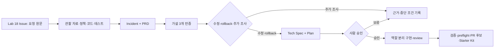

# Lab 20 — VOC에서 검토 가능한 PR 후보까지 연결하기

Lab 18의 GitHub Issue를 유일한 요청 원문으로 삼아 조사·계획·승인·역할 분리 구현·검증·PR 후보 작성을 한 흐름으로 연결합니다. 새 기법을 더하는 Lab이 아니라, 앞선 Lab에서 만든 정책·prompt·checklist·Skill을 실제 변경 하나에 필요한 만큼 선택해 쓰는 최종 실습입니다.

## 0. 이 랩이 끝나면

- Issue와 관찰 자료를 대조해 확인 사실·영향·미정을 담은 incident note와 PRD를 만듭니다.
- 반증 가능한 원인 가설 세 개를 비교하고 Tech Spec과 implementation plan을 사람 승인까지 연결합니다.
- planner·implementer·reviewer의 경계를 지키며 승인 범위만 구현하고 test·lint·typecheck로 검증합니다.
- diff·self-review·PR preflight를 거친 PR 후보, Risk·Rollback note, Starter Kit과 backlog를 남깁니다.

최종 결과는 GitHub PR 자체가 아니라 **사람이 검토해 PR로 올릴 수 있는 후보**입니다. Codex가 근거를 수집하고 초안을 만들더라도, 사건 범위·정책 결정·구현 승인·발견 수용·PR 준비 완료 판정은 사람이 맡습니다.

| 구분 | 이 Lab에서의 의미 |
| --- | --- |
| PRD | 왜 바꾸는지, 누구에게 어떤 영향이 있는지, 무엇을 완료로 볼지 정함 |
| Tech Spec | 현재 구조 안에서 책임 경계·변경 후보·검증·rollback 방식을 설명 |
| Implementation Plan | 승인된 변경 순서·파일 책임·중단 조건을 실행 단위로 기록 |
| PR 후보 | 실제 diff와 검증 결과만으로 변경·위험·rollback·reviewer note를 구성 |

## 1. 시작 전 상태 확인

- Lab 18의 Issue URL·탐색 기록·`issue-kickoff.md`와 승인 대기 plan을 찾을 수 있어야 합니다.
- Lab 17의 planner·implementer·reviewer prompt와 Lab 16의 PR preflight·PR description·self-review prompt를 읽을 수 있어야 합니다.
- Lab 19의 Automation 후보·중단 조건·Skill 실행 기록을 읽되, 이번 작업에 맞는 절차만 선택합니다.
- 작업 트리와 현재 branch를 확인하고 test·lint·typecheck의 기준선 결과를 남깁니다. 상태가 다르면 되감거나 즉석 수정하지 않고 차이를 기록한 뒤 멈춥니다.
- 기존 `it.fails()`가 있다면 일반 통과로 세지 않습니다. 구현 뒤 대상 동작이 고쳐져 예상 밖 통과가 되면, 정책 근거를 다시 확인한 후 일반 테스트로 전환할지 사람이 결정합니다.

커리큘럼의 세 시나리오는 관리자 상태 불일치, 주문 생성 API 실패율 상승, 관리자 주문 검색 실패입니다. 이 연속 실습에서는 Lab 18에서 등록한 Issue가 이미 요청을 선택했습니다. `labs/fixtures/l18-voc-report.md`와 `labs/fixtures/logs/l20-*.log`는 Issue를 바꾸는 새 요청이 아니라 사실을 확인하거나 가설을 반증하는 관찰 자료입니다. Issue와 무관한 신호는 이번 구현에 섞지 않고 backlog 후보로 보냅니다.

## 2. 실습 목표와 산출물

| 단계 | 핵심 작업 | 결과 |
| --- | --- | --- |
| E1 | Issue와 증거로 사건 경계·현재/기대 동작·PRD 정리 | `notes/incident-l20.md` 초안 |
| E2 | 세 가설을 반증하고 Tech Spec·plan 승인 | incident note와 승인된 기존 plan |
| E3 | 역할 분리 구현·독립 review·검증 | 승인 범위의 앱·테스트 diff |
| E4 | self-review·preflight·PR 후보·재사용 자산 정리 | 나머지 세 산출물과 완료 커밋 |



Issue는 요청의 정체성을, incident note는 이번 조사 snapshot을, plan은 승인된 실행 경계를, PR 후보는 실제 diff와 검증 결과를 소유합니다. 같은 내용을 네 문서에 복제하지 않습니다.

## 3. 실습

### E1. Issue에서 incident와 PRD 만들기

#### 설계 질문

- Issue의 보고 사실과 로그·코드·테스트로 확인한 사실은 어디서 갈리나요?
- 고객 영향·운영 영향·데이터 영향 중 현재 근거로 말할 수 있는 것은 무엇인가요?
- 현재 동작과 기대 동작을 어떤 관찰값으로 구분할 수 있나요?

#### 판단 기준

| 항목 | 남길 내용 | 피할 판단 |
| --- | --- | --- |
| 요청 원문 | Issue URL과 읽은 시점 | VOC·로그를 새 요구로 취급 |
| 증거 | 경로·시각·명령과 직접 관찰 | 상관관계를 원인으로 확정 |
| 영향 | 확인된 사용자·운영·데이터 범위 | 근거 없는 건수·심각도 |
| PRD | 문제·목표·완료 기준·제외 범위 | 구현 파일과 해법을 먼저 고정 |

#### 수행 순서

1. Issue를 다시 읽고 fixture·정책·현재 코드·테스트와 대조합니다.
2. 사건의 시간선, 현재/기대 동작, 영향, 확인 사실, 미정과 필요한 추가 증거를 나눕니다.
3. 같은 문서의 `PRD` 절에 문제·목표·완료 기준·제외 범위를 기록합니다.

#### 실행

```text
목표: ______ Issue를 요청 원문으로 사건과 PRD를 정리한다.
문맥: Issue URL, 관련 fixture·정책·코드·테스트와 Lab 18 탐색 기록을 대조한다.
제약: 원인·수정안을 확정하거나 앱·테스트를 수정하지 않고, 미확인은 미정으로 둔다.
완료 조건: notes/incident-l20.md에 시간선·영향·현재/기대·근거·미정·PRD를 남긴다.
```

#### 사람 확인

- [ ] Issue가 유일한 요청 원문이고 로그는 증거로만 쓰였는가?
- [ ] PRD의 완료 기준이 상태·응답·저장 결과처럼 관찰 가능한가?

#### 검증

- [ ] 모든 확인 사실에 Issue·파일·로그 또는 명령 근거가 있는가?
- [ ] 보고 사실·확인 사실·가설·사람 결정이 구분됐는가?
- [ ] 선택하지 않은 시나리오가 구현 범위에 섞이지 않았는가?
- [ ] 앱 코드와 테스트 diff가 없는가?

#### 흔한 실패와 대응

현재 코드에서 그럴듯한 줄을 찾았다고 원인으로 확정하지 않습니다. Issue와 맞지 않는 로그는 버리지 않고, 이번 사건과의 관련성이 미확인인 별도 신호로 기록합니다.

### E2. 가설을 좁히고 Tech Spec과 plan 승인하기

#### 설계 질문

- 각 가설을 틀렸다고 판정할 수 있는 관찰은 무엇인가요?
- 수정·rollback·추가 조사 중 현재 증거가 실제로 지지하는 행동은 무엇인가요?
- 선택한 행동이 기존 정책이나 미결 결정을 새로 바꾸나요?

#### 판단 기준

| 결정 | 선택할 수 있는 근거 | 다음 단계 |
| --- | --- | --- |
| 수정 | 원인 경계와 정책상 기대가 확인됨 | Tech Spec·plan 승인 |
| rollback | 안전한 이전 상태와 되돌릴 범위가 확인됨 | 영향·절차를 사람 승인 |
| 추가 조사 | 가설을 가를 핵심 증거가 없음 | 구현 없이 조사 항목 인계 |

가설은 서로 다른 이름 세 개가 아니라 서로 다른 증거로 반증할 수 있어야 합니다. Tech Spec은 해결 코드를 대신 쓰지 않고, 책임 경계·변경 후보·호환성·테스트·Risk·Rollback을 설명합니다. Implementation plan은 Lab 18에서 정한 plan 경로를 갱신해 사용하며 새 계획 파일을 추가하지 않습니다.

#### 수행 순서

1. 원인 가설 세 개에 근거·반증 방법·현재 판정을 붙입니다.
2. 수정·rollback·추가 조사 중 하나를 선택하고 선택하지 않은 행동의 이유도 남깁니다.
3. 수정이면 incident note에 Tech Spec을, 기존 plan에는 파일 책임·Steps·검증·중단 조건을 갱신합니다.
4. 사람이 PRD·Tech Spec·plan·미결 정책을 함께 보고 승인하거나 보류합니다.

#### 실행 1 — 가설과 대응 판단

```text
목표: incident의 원인 가설 세 개를 반증 가능한 형태로 비교한다.
문맥: @notes/incident-l20.md, Issue, 정책·코드·테스트·로그를 사용한다.
제약: 증거가 없는 원인과 정책을 확정하거나 파일을 수정하지 않는다.
완료 조건: 후보별 근거·반증 방법·판정과 수정·rollback·추가 조사 결론을 incident에 남긴다.
```

#### 실행 2 — 승인 후보 작성

```text
목표: 사람이 선택한 ______ 행동의 Tech Spec과 실행 plan을 완성한다.
문맥: incident·Issue·정책과 Lab 18에서 기록한 plan 경로를 사용한다.
제약: 미결 정책은 질문으로 남기고 앱·테스트를 수정하지 않는다.
완료 조건: 책임 경계·변경 후보·검증·Risk·Rollback·중단 조건을 기록하고 승인 대기한다.
```

#### 사람 확인

- [ ] 가설별 반증 결과와 선택한 행동이 같은 증거를 가리키는가?
- [ ] 변경 파일·Steps·검증·Risk·Rollback과 미결 항목을 승인할 수 있는가?

#### 검증

- [ ] 가설 세 개가 각각 근거와 다른 반증 방법을 갖는가?
- [ ] PRD·Tech Spec·plan의 책임이 중복되지 않는가?
- [ ] 승인 주체·대상·보류 항목이 plan에 기록됐는가?
- [ ] 승인 전 앱·테스트 diff가 없는가?

#### 흔한 실패와 대응

세 가설 중 하나를 억지로 수정안으로 만들지 않습니다. 증거가 부족하면 추가 조사가 정상 결과이며, rollback도 되돌릴 기준선과 영향이 확인되지 않으면 실행하지 않습니다.

### E3. 역할 분리로 구현·review·검증하기

#### 설계 질문

- 각 역할이 앞 역할의 결론을 복사하지 않고 어떤 근거를 독립 확인해야 하나요?
- 기존 기대 실패가 예상 밖 통과로 바뀌면 무엇을 의미하나요?
- reviewer 발견을 누가 수용·보류·범위 밖 인계로 나누나요?

#### 판단 기준

| 역할 | 책임 | 멈출 조건 |
| --- | --- | --- |
| planner | Issue·PRD·Tech Spec과 승인 plan의 정합성 확인 | 승인 누락·정책 충돌 |
| implementer | 승인 파일·Steps 안의 코드와 테스트 변경 | 범위 확대·새 정책 필요 |
| reviewer | plan·정책·diff·검증을 읽기 전용 대조 | 입력·검증 근거 부족 |
| 사람 | reviewer 발견의 수용·보류·인계 결정 | 영향이나 승인 범위 불명확 |

`it.fails()`는 알려진 정책 불일치를 감시합니다. 구현이 맞아져 테스트 본문이 통과하면 suite가 실패하는 것이 정상 신호입니다. 이때 테스트를 삭제하지 않고, 사람이 정책과 새 동작을 대조한 뒤 일반 `it()`로 바꿔 회귀 테스트로 유지합니다.

#### 수행 순서

1. 역할마다 새 세션에서 해당 prompt와 같은 Issue·incident·승인 plan을 입력으로 줍니다.
2. implementer는 승인 범위만 구현하고 관련 검증과 전체 test·lint·typecheck를 실행합니다.
3. reviewer는 구현 요약을 근거로 삼지 않고 원문·diff·실제 검증을 다시 읽습니다.
4. 사람이 발견을 분류하고 수용한 항목만 implementer에게 돌려보낸 뒤 전체 검증을 반복합니다.

#### 실행 — 역할별 공통 handoff

```text
역할: @docs/prompts/______.md의 계약을 따른다.
입력: Issue ______, @notes/incident-l20.md, 승인 plan ______와 현재 diff·검증 결과다.
제약: 역할의 금지 사항과 승인 범위를 지키고 새 정책은 결정하지 않는다.
완료 조건: 해당 역할의 출력·검증·Handoff를 근거와 함께 보고한다.
```

#### 사람 확인

- [ ] reviewer 발견마다 수용·보류·범위 밖 인계와 근거를 정했는가?
- [ ] 기대 실패 전환은 실제 정책 불일치가 해소된 항목에만 승인했는가?

#### 검증

- [ ] 실제 변경 파일이 승인 plan의 파일과 책임 안에 있는가?
- [ ] 완료 기준의 응답·상태·저장 결과를 값으로 검증하는가?
- [ ] test·lint·typecheck와 diff 형식 검사가 모두 실제로 실행됐는가?
- [ ] 실패·기대 실패·미실행이 일반 통과와 구분됐는가?
- [ ] reviewer가 파일을 수정하거나 발견을 스스로 승인하지 않았는가?

#### 흔한 실패와 대응

테스트를 통과시키기 위해 과거 이력을 지우거나 assertion을 완화하지 않습니다. 범위 밖 문제가 보여도 함께 고치지 않고 근거와 영향을 backlog 또는 별도 승인으로 넘깁니다.

### E4. PR 후보와 재사용 Starter Kit 완성하기

#### 설계 질문

- PR 설명의 각 주장이 실제 diff·검증·승인 기록에 연결되나요?
- rollback은 코드 역변경만이 아니라 데이터·운영 영향까지 설명하나요?
- 다른 repo로 가져갈 절차와 이번 사건의 답을 분리했나요?

#### 판단 기준

| 산출물 | 포함할 것 | 포함하지 않을 것 |
| --- | --- | --- |
| PR 후보 | Summary, 변경 범위, 검증, Risk, Rollback, reviewer note | 실행하지 않은 검증의 통과 주장 |
| Starter Kit | 요청 원문·계획·승인·역할·검증·중단·handoff 연결법 | 이번 도메인의 원인·필드·파일 답 |
| Backlog | 보류·범위 밖·비선택 시나리오·Automation 후보의 trigger와 완료 기준 | 근거 없는 우선순위와 약속 |

#### 수행 순서

1. `self-review.md`로 Issue·승인 plan·전체 diff·검증을 읽기 전용 대조합니다.
2. `pr-preflight.md`의 범위·정책·테스트·lint·typecheck·diff·실패 처리를 판정합니다.
3. `pr-description.md`로 `notes/pr-final-l20.md`를 만들고 Risk·Rollback·reviewer note와 사람/Codex 책임을 구분합니다.
4. 기존 자산을 가리키는 Starter Kit과 후속 backlog를 만들고, 사람이 staged 범위와 PR 준비 완료 여부를 확인한 뒤 커밋합니다.

#### 실행 1 — PR 후보

```text
목표: 현재 변경을 self-review와 PR preflight로 대조해 PR 후보를 작성한다.
문맥: Issue·incident·승인 plan·전체 diff·실제 검증과 기존 prompt·checklist를 사용한다.
제약: 미실행·기대 실패·보류를 통과로 쓰거나 앱 파일을 추가 수정하지 않는다.
완료 조건: notes/pr-final-l20.md에 변경·검증·Risk·Rollback·reviewer note·책임 구분을 남긴다.
```

#### 실행 2 — 재사용 자산과 backlog

```text
목표: 이번 흐름의 재사용 연결점과 후속 작업을 분리해 정리한다.
문맥: Lab 12~20에서 실제 사용한 기준·prompt·checklist·Skill·실행 기록을 사용한다.
제약: 이번 사건의 답을 일반 규칙으로 만들거나 소비자 없는 새 문서를 추가하지 않는다.
완료 조건: docs/agentic-workflow-starter-kit.md와 notes/backlog-l20.md를 완성한다.
```

#### 사람 확인

- [ ] PR 후보의 변경·검증·Risk·Rollback이 diff와 실제 결과에 연결되는가?
- [ ] staged 파일이 승인 범위와 네 필수 산출물뿐이며 비밀·고객 정보가 없는가?
- [ ] PR을 열 준비가 됐는지, 조건부인지, 중단인지 사람이 최종 판정했는가?

#### 검증

- [ ] `notes/incident-l20.md`에 사건·PRD·가설·Tech Spec·결정 근거가 있는가?
- [ ] `notes/pr-final-l20.md`가 실행·미실행 검증과 기대 실패를 구분하는가?
- [ ] Starter Kit이 기존 자산의 역할·입력·승인·중단·handoff를 연결하는가?
- [ ] backlog가 각 항목의 근거·우선순위·trigger·완료 기준을 갖는가?
- [ ] 전체 검사와 Lab 20 검사가 통과하고 커밋 범위가 사람이 승인한 내용과 같은가?

#### 흔한 실패와 대응

Starter Kit에 기존 문서 전문을 다시 쓰지 않습니다. 링크와 사용 조건만 남기고, 현재 PR의 관찰 결과는 incident·PR 후보·backlog에 둡니다.

## 4. Self-check

Lab 20 검사와 저장소의 test·lint·typecheck를 실행합니다. PR 후보에 기록한 결과가 실제 명령과 같은지, 시작 기준선 이후의 staged diff가 승인 범위와 일치하는지 사람이 다시 확인합니다. 실제 명령은 진행 화면의 데모를 따릅니다.

- [ ] Issue → PRD → Tech Spec → 승인 plan → 구현 → review → PR 후보가 경로로 연결되는가?
- [ ] Codex가 한 조사·작성·검증과 사람이 한 승인·분류·최종 판정이 구분되는가?
- [ ] 선택하지 않은 시나리오와 미결 정책을 완료한 것처럼 쓰지 않았는가?
- [ ] GitHub PR을 만들지 않고 검토 가능한 PR 후보와 커밋에서 멈췄는가?

## 5. 자주 하는 실수

- Issue보다 로그나 이전 대화를 새 요청 원문으로 사용합니다.
- 세 가설을 이름만 다르게 쓰거나, 증거 없이 익숙한 수정안을 선택합니다.
- reviewer 발견을 사람이 분류하기 전에 구현자가 모두 고칩니다.
- 테스트 통과만으로 정책·범위·Risk·Rollback 검토까지 끝났다고 판단합니다.

## 6. 다음 lab으로 넘기는 것

이 과정의 최종 handoff는 GitHub Issue, incident·PRD·Tech Spec, 승인 plan, 역할별 실행 근거, 앱·테스트 diff, 검증 결과, PR 후보, Starter Kit과 backlog입니다. 실제 PR 생성·merge·배포는 이 Lab의 완료 조건이 아니며, 조직의 review·CI·배포 정책에 따라 사람이 다음 행동을 결정합니다.

Starter Kit은 모든 산출물을 복사하는 묶음이 아니라 **다음 repo에서 무엇을 먼저 읽고, 어디서 멈추며, 어떤 증거를 사람에게 넘길지 찾게 하는 지도**입니다. Backlog의 Automation 후보도 Lab 19의 여섯 필드와 중단 조건을 충족할 때만 자동 실행 후보로 다시 심사합니다.
